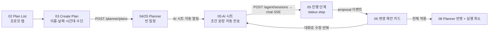
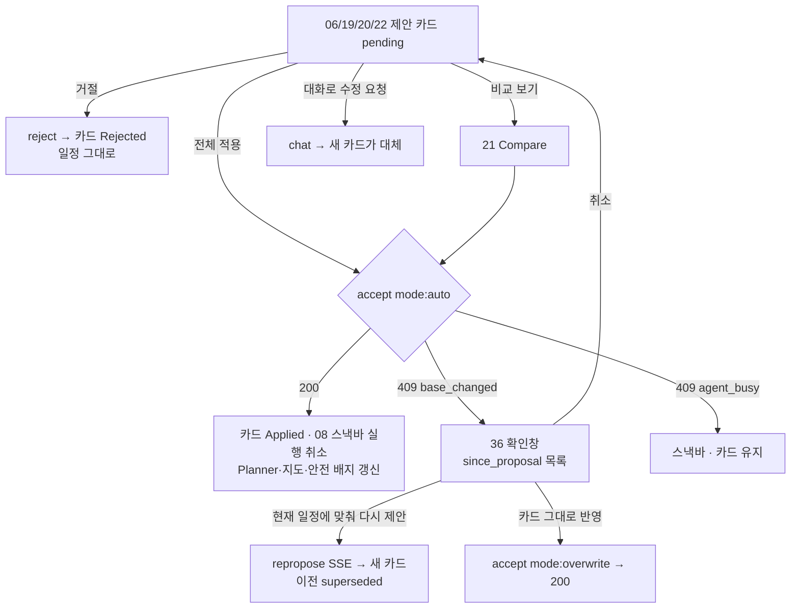
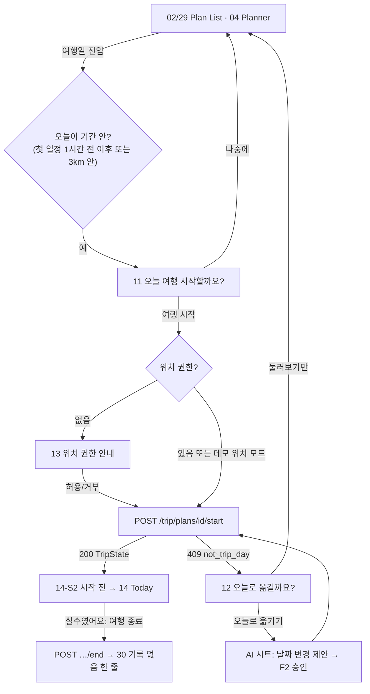
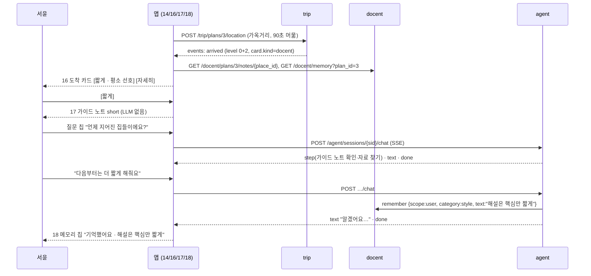
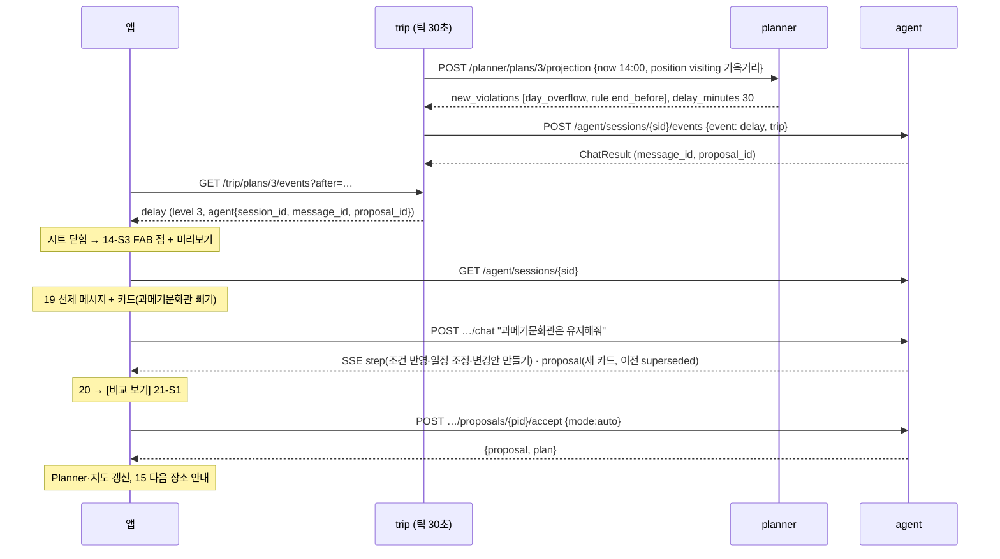
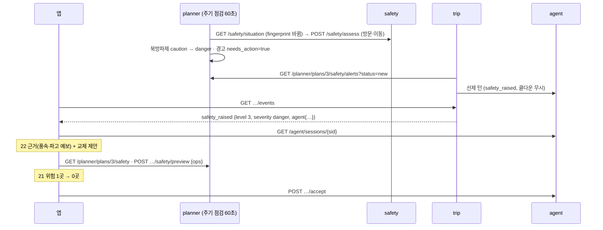
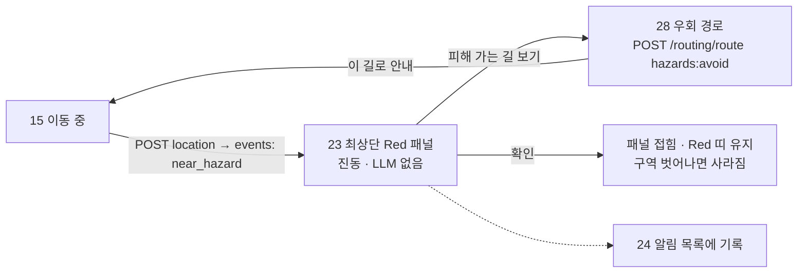
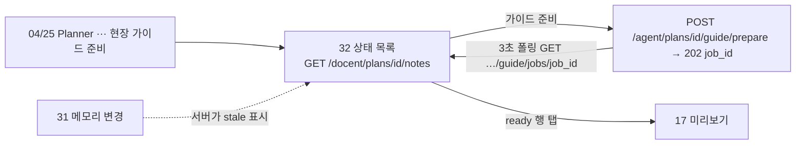
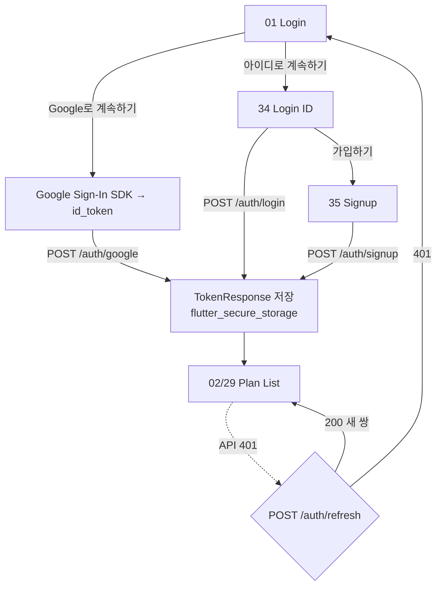

# flows — 서비스 흐름

각 흐름은 단계마다 **화면 ID · 사용자 동작 · 부르는 API · 받는 이벤트**를 적는다. 화면 ID 는 [README.md §5](README.md#5-화면-목록).
Figma 흐름도: 「Flows — 동행 모드」 페이지 — F3 `73:8263`, F4 `73:8364`, F5 `73:8445`, F6 `73:8546`, F7 `73:8607`.

| 흐름 | 데모 장면 | 우선 |
|---|---|---|
| [F1](#f1-ai-로-계획-만들기) AI 로 계획 만들기 | ① | P0 |
| [F2](#f2-제안-승인--거절--base_changed--다시-제안) 제안 승인·거절·base_changed·다시 제안 | ①③④ | P0 |
| [F3](#f3-여행-시작) 여행 시작 (정상·다른 날·실수) | ②~④ 시작 | P0 |
| [F4](#f4-도착--해설-카드--가이드-노트--추가-질문--더-짧게) 도착 → 해설 → 추가 질문 → "더 짧게" | ② | P0 |
| [F5](#f5-지연--ai-선제-메시지--제약-반영--승인) 지연 → 선제 메시지 → 제약 반영 → 승인 | ③ | P0 |
| [F6](#f6-안전-상승--ai-선제-메시지--비교--승인) 안전 상승 → 선제 메시지 → 비교 → 승인 | ④ | P0 |
| [F7](#f7-위험-구역-접근-경고) 위험 구역 접근 경고 | ④ 보조 | P0 |
| [F8](#f8-출발--다음-장소-안내) 출발 → 다음 장소 안내 | ③ 뒤 | P1 |
| [F9](#f9-여행-종료--하루-요약) 여행 종료·하루 요약 | — | P1 |
| [F10](#f10-가이드-준비) 가이드 준비 | ② 준비 | P1 |
| [F11](#f11-로그인) 로그인 | — | P0 |

---

## F1. AI 로 계획 만들기

| # | 화면 | 사용자 | API | 받는 것 |
|---|---|---|---|---|
| 1 | 02 → 03 | "AI로 계획 만들기" | `POST /planner/plans` | PlanDetail |
| 2 | 05 | (자동) 조건 문장 전송 · 이후 "어머니가 오래 걷기 힘들어요" 등 | `GET /agent/sessions?plan_id=` (없으면 `POST /agent/sessions`), `POST …/chat` | SSE `start` → `status`·`step`·`text`·`recommendation` → `proposal` → `steps_done` → `done` |
| 3 | 05 | Agent 의 추가 질문에 답 | `POST …/chat` | `text` (카드 없음) |
| 4 | 06 | 카드 확인, [자세히 보기](before/after) | — | `ProposalDetail.changes` |
| 5 | 06 → 08 | [전체 적용] | F2 | `{proposal, plan}` |
| 6 | 32 | (선택) 가이드 준비 | F10 | |

- 진행 영역: `status` 한 줄 교체, `step` 은 같은 id 갱신·새 id 추가, `steps_done` 이 오면 한 줄로 접는다 (agent §3.1). 기존 앱은 옛 이벤트(`tool_call`)를 쓴다 → gaps (c).
- Stop: 스트림을 끊는다. 서버가 턴을 중단하고 그때까지 기록을 남긴다.

## F2. 제안 승인 · 거절 · base_changed · 다시 제안

| 단계 | API | 결과 |
|---|---|---|
| 승인 | `POST /agent/sessions/{sid}/proposals/{pid}/accept {"mode":"auto"}` | 200 `{proposal, plan}` · 409 `base_changed {base_version, current_version, since_proposal, overwrite_effect}` · 409 `proposal_not_pending` · 409 `agent_busy` |
| 그대로 반영 | 같은 accept `{"mode":"overwrite"}` | 200 (`decision: overwritten`) |
| 다시 제안 | `POST …/proposals/{pid}/repropose` | SSE (대화에 "이전 제안을 현재 일정에 맞춰 다시 만들어줘." 가 남음) |
| 거절 | `POST …/proposals/{pid}/reject` | 200 ProposalDetail. 이벤트에서 온 제안이면 같은 원인으로는 더 나빠질 때만 다시 알림 |
| 실행 취소(08) | 앱이 승인 전 일정과의 차이를 ops 로 만들어 `POST /planner/plans/{id}/ops` | 한계 → gaps (a)(c) |

- 동행 중 도착·완료(진행 상태)는 `version` 을 올리지 않으므로 그것만으로 base_changed 가 나지 않는다 (`progress_version`).

## F3. 여행 시작

| # | 화면 | 사용자 | API | 받는 것 |
|---|---|---|---|---|
| 1 | 29/04 | 계획 열기 | `GET /trip/plans/{id}/state` | `active=false` |
| 2 | 11 | [여행 시작] | `POST /trip/plans/{id}/start {"session_id": 최근 세션}` | 200 TripState / 409 `not_trip_day {start_date, end_date}` / 404 |
| 3 | 13 | 권한 허용·거부 | (OS) | 거부 → 14-S1 배너 |
| 4 | 14-S2 | 첫 장소로 이동 | `POST …/location` (30m 또는 30~60초) | `{state, events}` · `current.state=idle` |
| 5 | 14 | 도착 | — | `arrived` → F4 |
| 6 | 12 | [오늘로 옮기기] | AI 시트에 "일정을 오늘(10/9)로 옮겨줘" 전송 → 카드 → F2 | 승인 후 다시 2 |
| 7 | 14 | (실수) [여행 종료] → 확인 | `POST …/end` | `active=false, ended_reason:user` → 30 |

- 같은 날 다시 start 하면 멱등(200, 같은 상태). 다른 날 진행 중이면 서버가 이전 것을 끝내고 새로 시작한다.
- 여행 시작 때 가이드 노트가 없는 장소가 있으면 서버(docent §3.2)가 준비를 시작한다. 앱은 11 시트에 "아직 준비 안 된 n곳은 지금 준비할게요" 한 줄.

## F4. 도착 → 해설 카드 → 가이드 노트 → 추가 질문 → "더 짧게"

| # | 화면 | 사용자 | API | 받는 것 |
|---|---|---|---|---|
| 1 | 14 | (걷기) | `POST …/location` | `arrived` (`out_of_order` 면 카드 문구 동일, 순서만 다름) |
| 2 | 16 | 카드 확인 | `GET /docent/plans/{plan_id}/notes/{place_id}`, `GET /docent/memory?plan_id=` (style) | GuideNote(status), memory |
| 3 | 17 | [짧게]/[자세히] | — (노트 그대로) | |
| 4 | 18 | 질문 | `POST /agent/sessions/{sid}/chat` | SSE |
| 5 | 18 | "더 짧게" | 같음 | 메모리 칩 근거: remember 단계(kind 미정) 또는 `memory_version` 증가 → gaps (b) |
| 6 | 다음 장소 16 | — | | [짧게]가 "평소 선호"로 강조 |

- 노트가 없거나 `failed` 면 16-S1: 카드 [지금 설명 듣기] → AI 시트에서 즉석 생성.

## F5. 지연 → AI 선제 메시지 → 제약 반영 → 승인

| # | 화면 | 사용자 | API | 받는 것 |
|---|---|---|---|---|
| 1 | 14 (가벼운 지연) | 머묾 | (서버 틱) | `state.delay_minutes`, ETA 칩 Amber — 알림 없음 |
| 2 | 14-S3 | — | 폴링 `GET …/events?after=` | `delay` level 3 (`payload.new_violations`, `payload.delay_minutes`) |
| 3 | 19 | 미리보기/FAB 탭 | `GET /agent/sessions/{sid}` | 선제 메시지(`agent.message_id`), 카드(`agent.proposal_id`) |
| 4 | 19 | 칩 "과메기문화관은 유지해줘" | `POST …/chat` | SSE `proposal` (이전 superseded) |
| 5 | 20 → 21-S1 | [비교 보기] | (카드의 before/after) | 규칙 위반 2→0, 종료 18:07→16:55 |
| 6 | 21-S1 | [전체 적용] | `POST …/accept {"mode":"auto"}` | 200 / 409 → F2 |
| 7 | 14/15 | — | PlanDetail, safety, 경로 다시 | |

- "대안 2개": 카드는 한 턴에 하나라 두 번째 대안은 답변 텍스트 + 칩("②번으로 해줘")으로 고른다 → gaps (b) "여러 안 카드".
- 사용자가 거절하면 같은 원인(같은 위반)으로는 다시 오지 않는다. 더 나빠지면(새 위반) 다시 온다.

## F6. 안전 상승 → AI 선제 메시지 → 비교 → 승인

| # | 화면 | 사용자 | API | 받는 것 |
|---|---|---|---|---|
| 1 | 25 (계획 때) | — | `GET /planner/plans/{id}/safety`, `GET …/safety/alerts?status=new` | 주의 배지·배너 |
| 2 | 14 | — | 폴링 | `safety_raised` (level 3) · 배지 Red |
| 3 | 22 | 미리보기 탭 | `GET /agent/sessions/{sid}` | 선제 메시지 + 카드 |
| 4 | 21 | [비교 보기] | before: `GET …/safety` · after: `POST …/safety/preview {"ops": proposal.ops}` · 경로: `POST /routing/route` ×2 | 위험 1→0 |
| 5 | 21 | [전체 적용] | accept | F2 |
| 6 | 14/25 | — | | 해제되면 `safety_eased` 토스트 |

- 계획 단계(여행 전)에는 이벤트가 없다. 같은 경고는 25 의 배너 "✨ AI로 조정"으로 사용자가 직접 연다.

## F7. 위험 구역 접근 경고

| # | 화면 | 사용자 | API | 받는 것 |
|---|---|---|---|---|
| 1 | 15 | 걷기 | `POST …/location` | 응답 `events`: `near_hazard` (message 고정 문구) |
| 2 | 23 | — | `GET /safety/avoid` (구역 다각형) | |
| 3 | 28 | [피해 가는 길 보기] | `POST /routing/route {"mode":"walk","stops":[현재, 다음 장소],"hazards":"avoid","steps":true}` | `hazards.baseline`, `detour_minutes`, `avoided`, `note` |
| 4 | 24 | 알림 열기 | `GET …/events`, `POST …/events/{id}/seen` | |

## F8. 출발 → 다음 장소 안내

| # | 화면 | 사용자 | API | 받는 것 |
|---|---|---|---|---|
| 1 | 14 | 장소를 떠남 | `POST …/location` | `departed` (level 1) |
| 2 | 15 | 토스트 "다음은 구룡포항, 도보 8분" [경로 보기] | `POST /routing/route {stops:[현재, 다음], hazards:"avoid"}` | 경로선 + `steps` |
| 3 | 15 | (걷기) | 위치마다 가장 가까운 `geometry` 점 → `begin_index` 로 현재 안내 한 줄 | |
| 4 | 15 | 차량 구간이면 [카카오맵에서 열기] (P2) | 외부 앱 | |

## F9. 여행 종료 · 하루 요약

| # | 화면 | 사용자 | API |
|---|---|---|---|
| 1 | 14 패널 / Planner ⋯ | [여행 종료] | — |
| 2 | 다이얼로그 (States_Feedback) | [마치기] | `POST /trip/plans/{id}/end` |
| 3 | 30 | 요약 보기 | PlanDetail(오늘 `arrived_at`·`done_at`), `GET …/events`, `GET …/proposals?status=accepted`, `GET /docent/memory` — 앱이 계산 (요약 API 없음 → gaps) |
| 4 | 30 → 29 | [계획 목록으로] | |
| 자동 | 앱 재진입 | state `active=false, ended_reason:"auto"` 이고 요약을 아직 안 봤으면 30 한 번 | |

## F10. 가이드 준비

| # | 화면 | 사용자 | API |
|---|---|---|---|
| 1 | 31 | (선택) 나에 대해 확인·지우기 | `GET /docent/memory?plan_id=`, `DELETE /docent/memory/{id}` |
| 2 | 32 | [가이드 준비] | `POST /agent/plans/{plan_id}/guide/prepare` → `{job_id}` |
| 3 | 32 | 기다림 | `GET /agent/plans/{plan_id}/guide/jobs/{job_id}` 3초, 끝나면 `GET /docent/plans/{plan_id}/notes` |
| 4 | 32 | failed/stale 칩 | 같은 prepare |

## F11. 로그인

| 오류 | 화면 표현 |
|---|---|
| 401 `invalid_credentials` | 34 비밀번호 필드 아래 "아이디 또는 비밀번호가 맞지 않아요" |
| 429 `too_many_attempts {retry_after}` | 34-S1 잠김 박스 + 버튼 비활성 (남은 시간) |
| 409 `login_id_taken` | 35 아이디 필드 |
| 422 `weak_password` | 35 비밀번호 필드 |
| 401 `invalid_google_token` / 503 `google_unavailable` | 01 스낵바 "Google 로그인에 실패했어요" / "잠시 후 다시" |
| 401 `refresh_token_reused` | 토큰 삭제 → 01 + "다른 곳에서 로그인 정보가 쓰여 다시 로그인해 주세요" |

- 로그아웃: `POST /auth/logout {refresh_token}` → 토큰 삭제 → 01. 탈퇴: `DELETE /users/me` (33, 확인 2단계).
- `created: true` (Google 첫 로그인) → 02 대신 이름 확인 시트(선택, P2).
