# L1 Figma 대조 — 기반과 계획 모드 (feat/app-l1, 2026-10-10)

화면마다 **Figma 프레임 | 앱 캡처**를 나란히 둔 이미지(`l1/cmp/`)와 다른 점, 고친 것 또는 그대로 둔 이유.

| 캡처 | 어떻게 만들었나 |
|---|---|
| `l1/figma/*.png` | figma-bridge `save_screenshots` (파일 「GuryongMate」 Page 1, scale 1, 390×844) |
| `l1/app/it_*.png` | `integration_test/app_flow_test.dart` — Windows 앱을 **각본 LLM 스택**(scripted + safety mock, 가상 시각 10/09 10:00 calm)에 붙여 F1·F2 를 실제로 누른 화면 |
| `l1/app/fx_*.png` | `test/capture_test.dart` — Figma 와 같은 장면(장면 ④ 북방파제 위험 등)을 **녹화 fixture** 로 그린 화면. 맑은 고딕으로 그려 Noto Sans KR 과 글자 폭이 조금 다르고, 지도 타일은 네트워크가 없어 비어 있다 |
| `l1/app/claude_*.png` | `integration_test/claude_check_test.dart` — 실제 Claude(Haiku 5.5) 3턴 |

Figma 의 데모 문구(구룡포 여행 3일, 북방파제 "주의 · 풍속 11m/s" 등)는 예시 값이고, 앱은 같은 자리에 **녹화/실제 데이터**를 그린다. 아래 "다른 점"은 데이터 차이가 아닌 **구조·스타일** 차이만 적는다.

## 요약

| 화면 | 결과 | 남은 차이 (이유) |
|---|---|---|
| 01 Login | 일치 | 하단 "서버 설정" 링크 추가 (명세 00-existing §01) |
| 05 AI 시트 · 진행 | 일치 | 단계 줄에 kind 아이콘 추가 (작업 지시: kind 별 아이콘). 기억 칩 |
| 06 변경 제안 | 일치 | "자세히 보기 ›" → "비교 보기 ›" (명세 06), 조건 줄 |
| 06B 추천 | 거의 일치 | 별점·미추가 후보의 이동 시간 없음 (gaps b22) |
| 07 Map | 일치 | 경로선이 실제 길(routing geometry), 차량 구간 점선 |
| 08 After Apply | 일치 | 스낵바 "실행 취소" 앞 ↶ 아이콘 없음 (SnackBarAction 제약, 문구로 충분) |
| 21 Compare | 일치 | 지도 라벨이 겹칠 수 있음 (구역 라벨 + 새 장소 라벨) |
| 25 Planner Safety | 일치 | 배너 단계 색이 데이터(위험)에 따라 Red |
| 26 Safety Detail | 일치 | — |
| 27 Outlook | 일치 | 요약 문장은 시간 띠에서 만든 기계 문장 |
| 28 Map Safety · 28-S1 | 일치 | — |
| 29 Plan List | 일치 | [동행 화면 열기]는 L2 전까지 계획 화면을 연다 |
| 31 Memory | 일치 | — |
| 32 Guide Prep | 일치 | 노트 목록만으로는 출처 수를 모름 (gaps b20) |
| 33 Settings | 일치 | "장소로 이동"은 안내만 (동행 모드 전용, gaps b13) |
| 34 · 34-S1 · 35 | 일치 | — |
| 36 Base Changed | 일치 | "자세히"(overwrite_effect, P2) 접힌 줄 추가 |

## 화면별

### 01 Login — 
- 같음: 로고·이름 "구룡메이트"·태그라인·두 버튼·약관.
- 추가: 하단 "서버 설정" (로그인 전 서버 주소, 00-existing §01). Windows 데스크톱은 Google Sign-In 미지원이라 누르면 안내 스낵바.

### 05 AI Bottom Sheet — 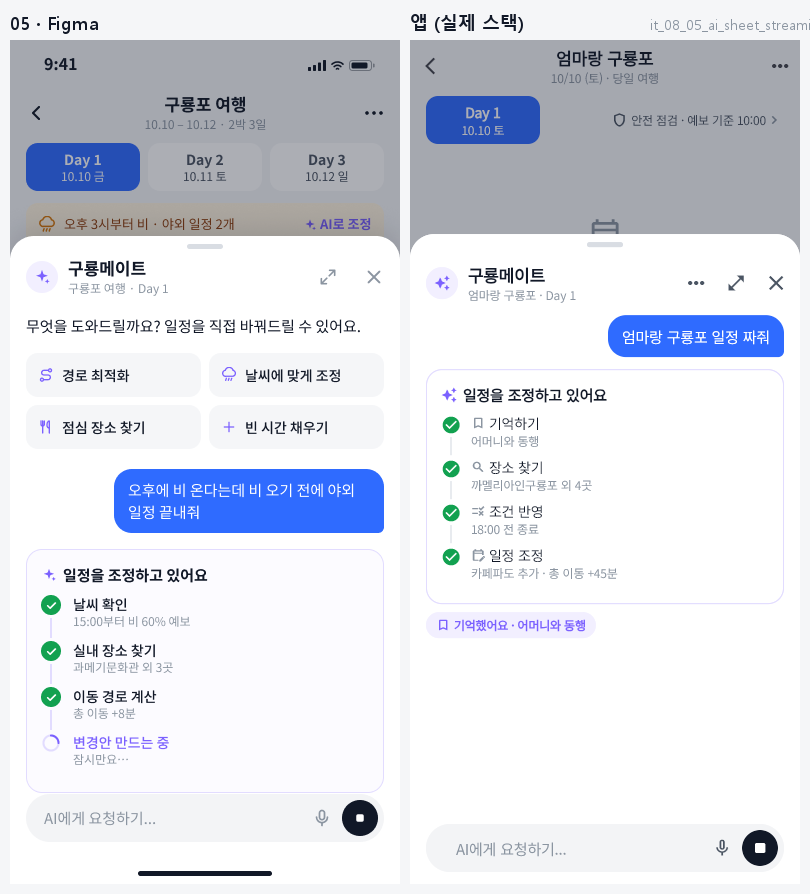
- 같음: 헤더 "구룡메이트 · {계획명} · Day n", 진행 카드(✨ status 한 줄 + 단계 목록, done Green ✓·running Purple 스피너), Stop 버튼(■).
- 고침: 서버 status 끝의 마침표를 제목에서 뺐다 ("일정을 조정하고 있어요." → Figma 처럼 마침표 없음).
- 다름: 단계 제목 앞 kind 아이콘(14px, 회색 · running 이면 Purple) — 작업 지시 "kind 별 아이콘·제목·결과". `memory` 단계가 끝나면 "기억했어요 · …" 칩 (gaps b4).
- 빠른 실행: "날씨에 맞게 조정"(Figma) 대신 "날씨·안전 확인" (gaps c10: 날씨 도구가 아니라 check_safety).

### 06 AI Change Preview — 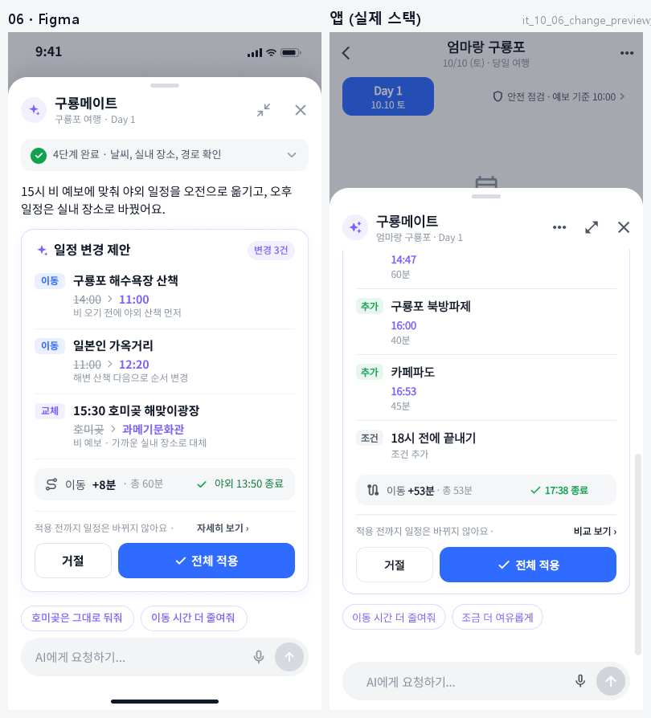
- 같음: 카드 구조(배지·제목·from › to·이유), Route Impact 박스(이동 ±·총·종료), 거절/전체 적용, 후속 칩.
- 다름(명세대로): "자세히 보기 ›" → **"비교 보기 ›"** (21), 안내 "적용 전까지 일정은 바뀌지 않아요", 규칙 추가는 "조건" 줄(코드 표기를 떼고 괄호 안 사람 말만, gaps b21), 대체된 제안은 접힌 회색 한 줄(20).
- steps_done 요약 줄은 Figma 처럼 답변 위에 있다 (캡처는 카드가 보이게 스크롤한 상태).

### 06B AI Place Recommendation — 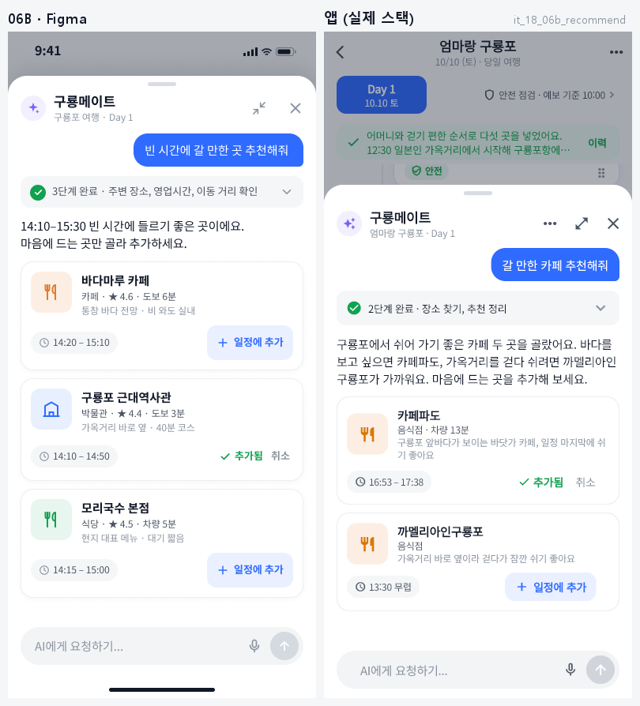
- 같음: 썸네일·이름·메타·이유·시간 칩·[+ 일정에 추가] / [✓ 추가됨 · 취소].
- 다름: 별점 없음, 일정에 없는 후보는 이동 시간 대신 "13:30 무렵"(time_hint) — 데이터 없음 (gaps b22). 기간 밖 후보는 "여행 기간 밖이에요"(버튼 없음).

### 07 Map / 08 After Apply — 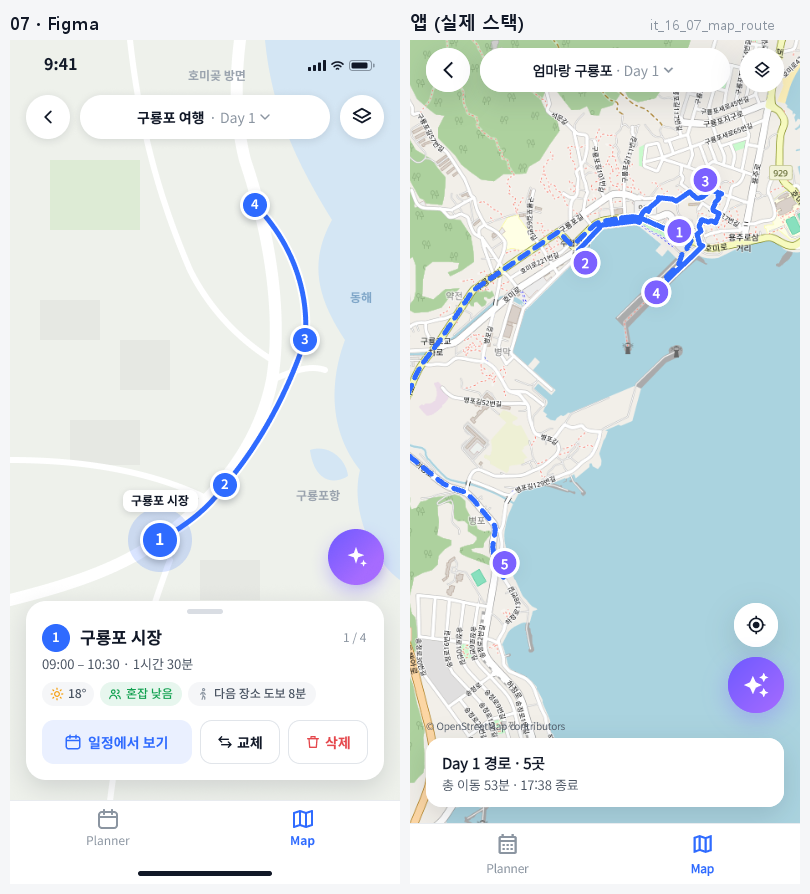 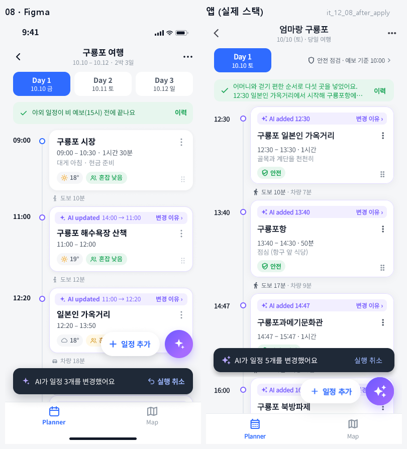
- 07: 핀 직선 → `POST /routing/route` geometry 를 구간마다 (도보 실선, 차량·직선 근사 점선). 요약 카드에 estimate 구간이 있으면 "일부 구간 약".
- 08: 같은 구조(성공 배너·AI added/updated 배지·스낵바). 스낵바 4초(c9, 기존 5초). 날씨·혼잡 칩 자리는 위험 배지(25).

### 21 Compare — 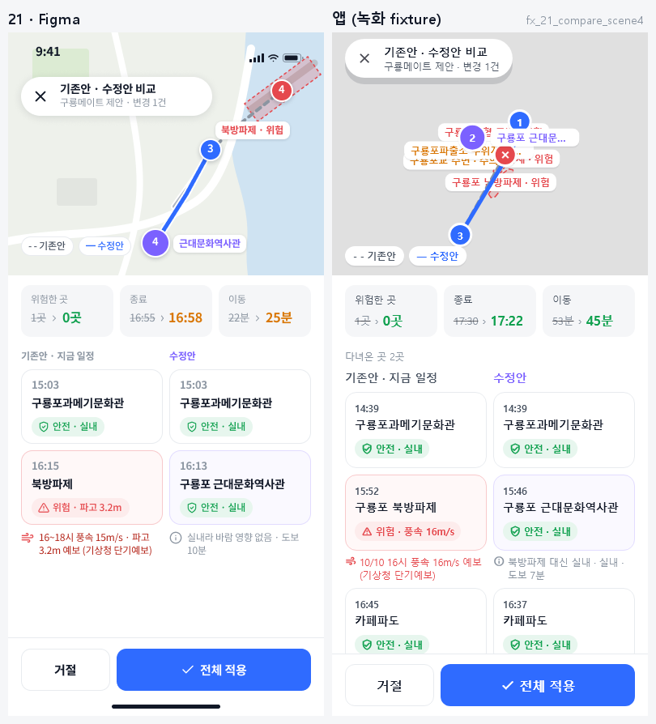
- 같음(장면 ④): 상단 pill, 범례, 지표 3칸(위험한 곳 1곳→0곳 Green · 종료 17:30→17:22 · 이동), 두 열 타임라인(빠지는 행 Red 테두리 #FFF8F8, 새 행 Purple #FAF9FF), 근거 줄(기존: hazard reason + source / 수정: 메모·실내·이동), 하단 [거절][전체 적용].
- 고침: 종료 시각 지표가 **일찍 끝나면 Green** (처음엔 변화만 Amber 였음).
- 다름: "다녀온 곳 2곳" 줄(명세 21 데이터 — 동행 중 done 숨김). 지도에서 위험 구역 라벨과 새 장소 라벨이 겹칠 수 있다(라벨 배치 최적화 없음).
- 실제 스택 F1(빈 일정 → 5곳)에서는 기존안 열이 비고 지표가 "0분 → 53분" — 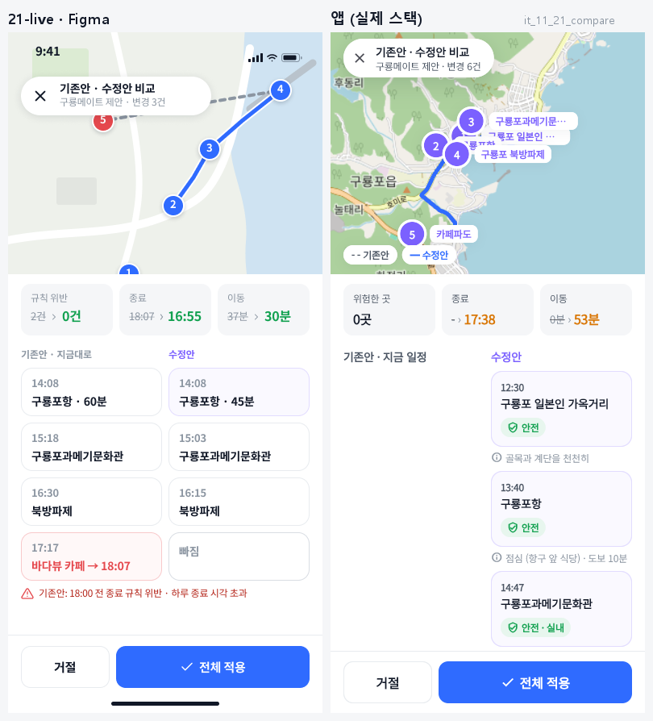 (Figma 21-S1 은 지연 장면이라 레이아웃 참고용).

### 25 Planner Safety — 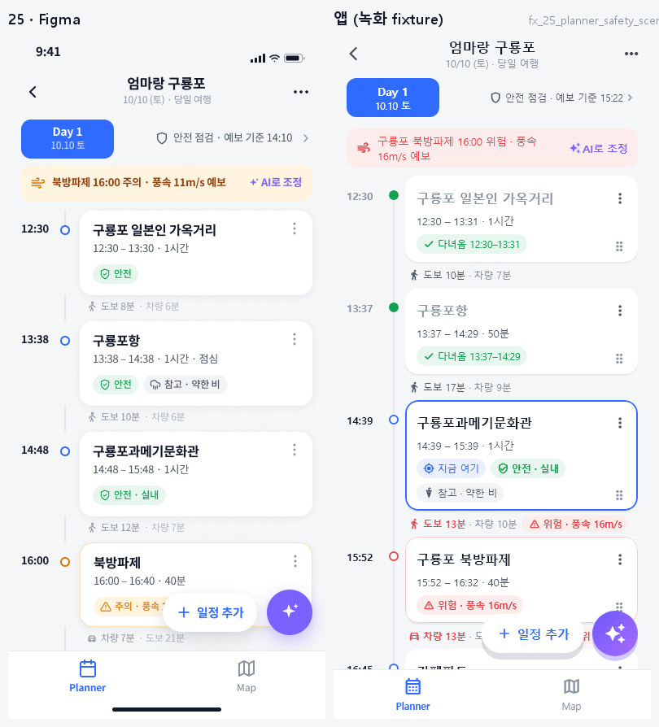 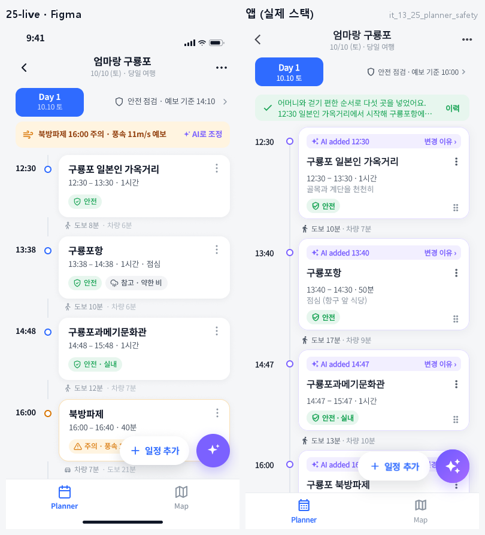
- 같음: Day 탭 옆 "🛡 안전 점검 · 예보 기준 HH:MM ›", 안전 경고 배너 + "✨ AI로 조정", 위험 배지(안전/안전 · 실내/주의·위험 · 근거), 회색 참고 칩("참고 · 약한 비"), 위험 카드 테두리·노드 색, 구간 "도보 n분 · 차량 m분"(다른 수단 회색).
- 다름: 장면 ④ 데이터라 배너가 Red(위험), 구간 위험이면 구간 줄에 작은 배지("위험 · 수위 등급 3"). 동행 중 진행(다녀옴·지금 여기)도 같은 화면에 (25 표).
- risk=null 은 회색 "판단 불가 · 데이터 없음" / "예보 전 · MM/DD부터" (위젯 테스트로 확인, Green 아님).

### 26 Safety Detail — 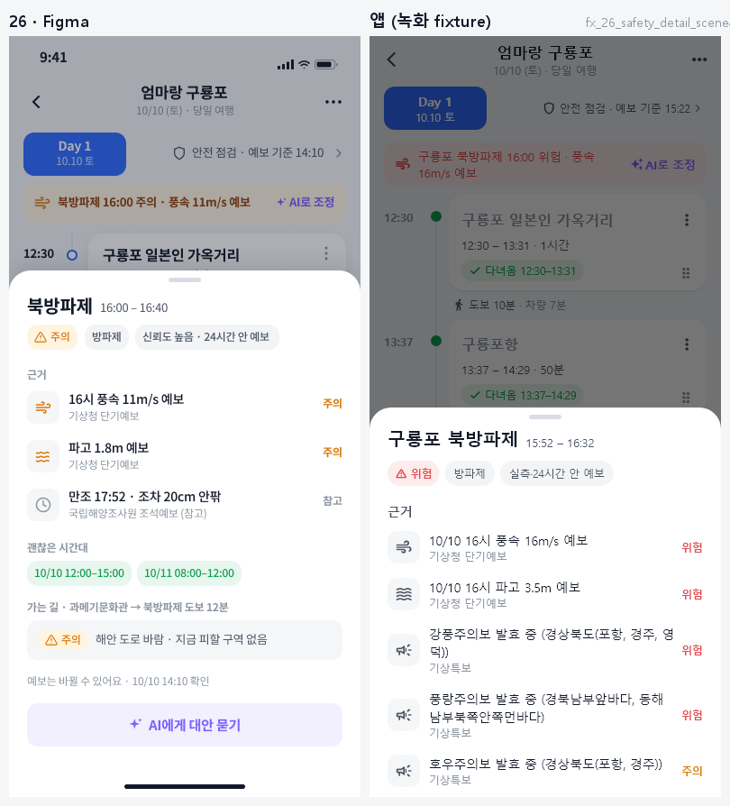
- 같음: 제목·시간, 배지 줄(단계 · 장소 성질 · 신뢰도), 근거 행(아이콘 36 + reason + source + 단계), 괜찮은 시간대 Green 칩, 가는 길, "예보는 바뀔 수 있어요 · 확인 시각", [✨ AI에게 대안 묻기].
- 근거가 5개라 캡처 아래는 스크롤(시트 최대 72%).

### 27 Safety Outlook — 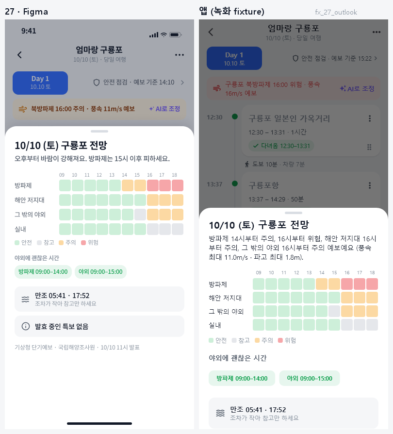
- 같음: 제목, 요약, 시간 띠 4행 × 09~18 (안전 #CDEFD9 · 참고 #E5E7EB · 주의 #FCD9A3 · 위험 #F6A6A9), 범례, 야외에 괜찮은 시간 칩, 만조, 특보.
- 다름: 요약 문장은 시간 띠로 만든 사실 문장("방파제 14시부터 주의, 16시부터 위험 …")이라 Figma 의 자연스러운 문장보다 딱딱하다 (safety advice/guidance 는 LLM 지시문이라 쓰지 않음, README §6.2).
- 응답 필드명은 backend 스키마로 확인 (gaps b10).

### 28 Map Safety · 28-S1 Layers — 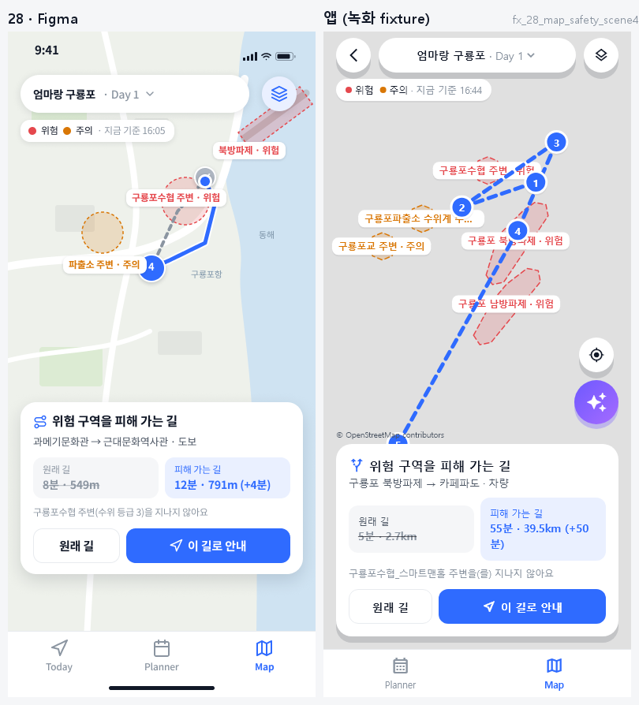 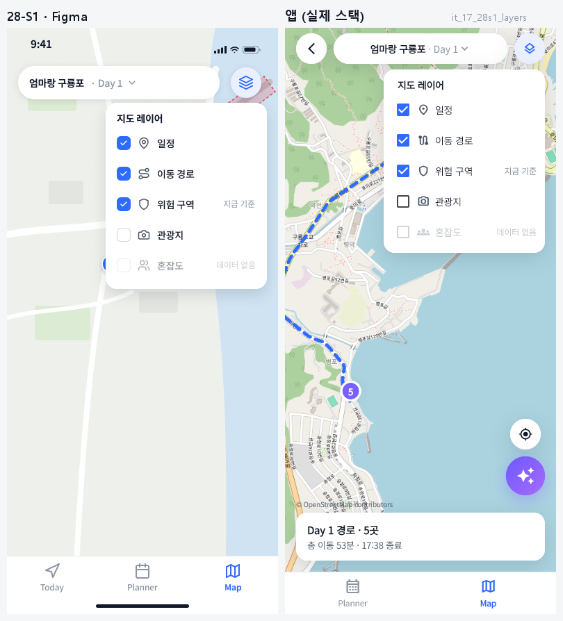
- 같음: 범례 pill "● 위험 ● 주의 · 지금 기준 HH:MM", 구역 다각형(18% + 점선) + 이름 라벨, 우회 카드(원래 길 취소선 / 피해 가는 길 +n분, "…을(를) 지나지 않아요", [원래 길][이 길로 안내]), 레이어 패널 "위험 구역 · 지금 기준", "혼잡도 · 데이터 없음"(50%).
- 고침: "지금 기준" 시각을 기기 시각이 아니라 `/safety/avoid` 의 `now`(가상 시각) 로.
- 다름: 우회 카드는 이 날 안전 점검의 travel 항목에 `detour.avoided` 가 있을 때 자동으로 뜬다. [이 길로 안내]는 계획 모드에선 두 경로를 지도에 그리기만 (실제 안내는 L2 의 15).

### 29 Plan List Status — 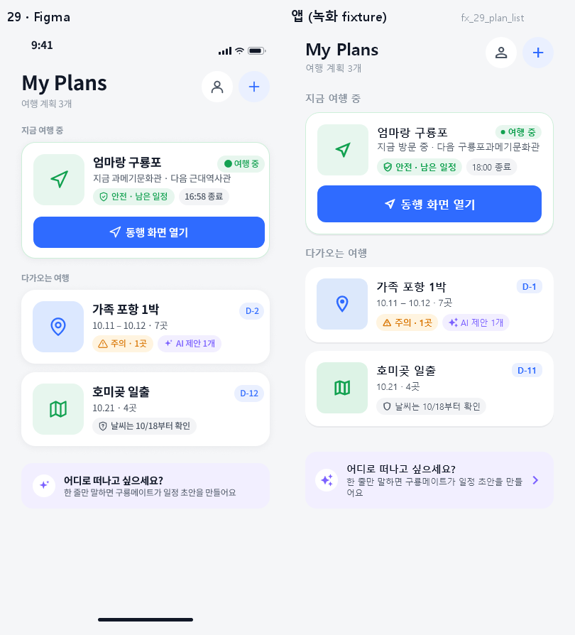
- 같음: 계정 버튼, "지금 여행 중" 카드(Green 테두리, ● 여행 중, 지금·다음, 남은 일정 배지, 종료, [동행 화면 열기]), 다가오는 카드(D-n, 위험 배지 "주의 · 1곳", AI 제안 n개, 3일 넘게 남으면 "날씨는 MM/DD부터 확인"), 프로모 문구.
- 다름: [동행 화면 열기]·"오늘 여행 시작"(11)은 L2 — 지금은 계획 화면을 연다. 여행일인데 시작 전이면 D-day 자리에 "오늘 여행".

### 31 Memory — 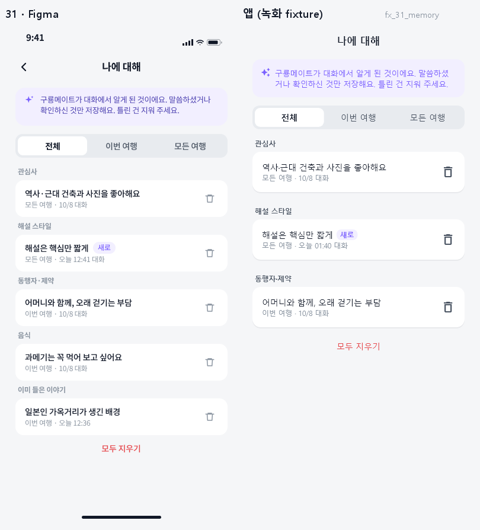
- 같음: 안내 박스, Segment, 분류 그룹, 행(내용 + 범위·날짜·출처 + 삭제), "새로" 칩, 모두 지우기.
- 지우기는 확인 없이 + 스낵바 "지웠어요 · 되돌리기"(명세). 캡처 항목 일부는 f4 녹화 + 예시 항목.

### 32 Guide Prep — 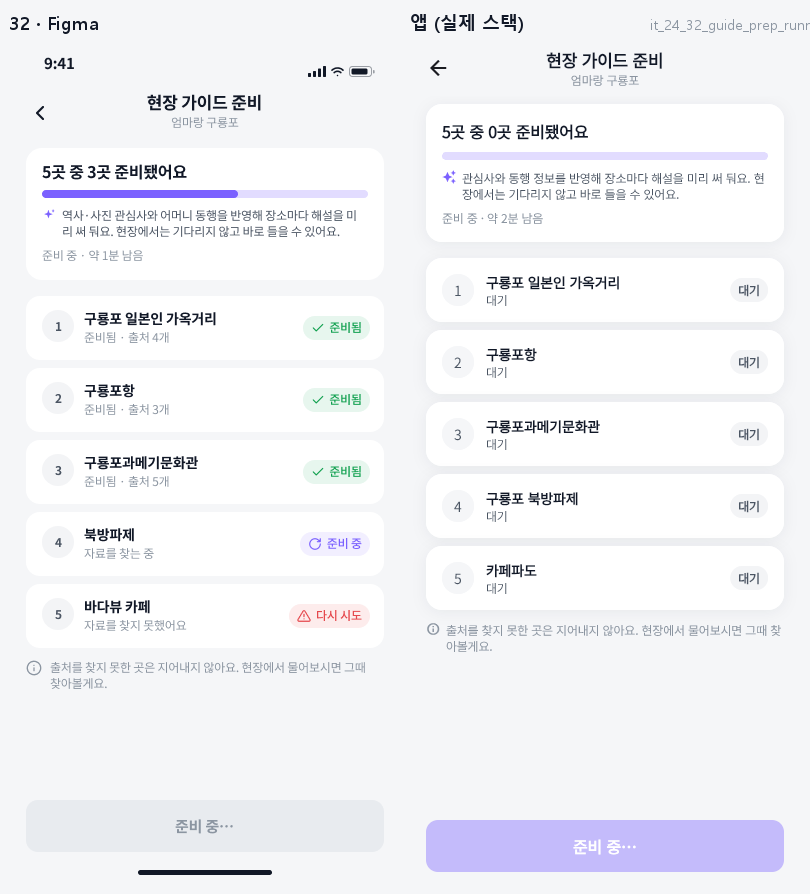
- 같음: 요약 카드(n곳 중 m곳, 진행 바, ✨ 설명, "준비 중 · 약 n분 남음"), 장소 행(순서·이름·상태 문구·칩), 안내, 하단 버튼(준비 중… / 가이드 준비 / 다시 준비 / 모두 준비됐어요).
- 다름: 화면을 다시 열면 출처 수를 모른다 (노트 목록에 없음, gaps b20). 준비된 행을 누르면 간단한 노트 미리보기 시트(17 은 L2).

### 33 Settings · Demo — 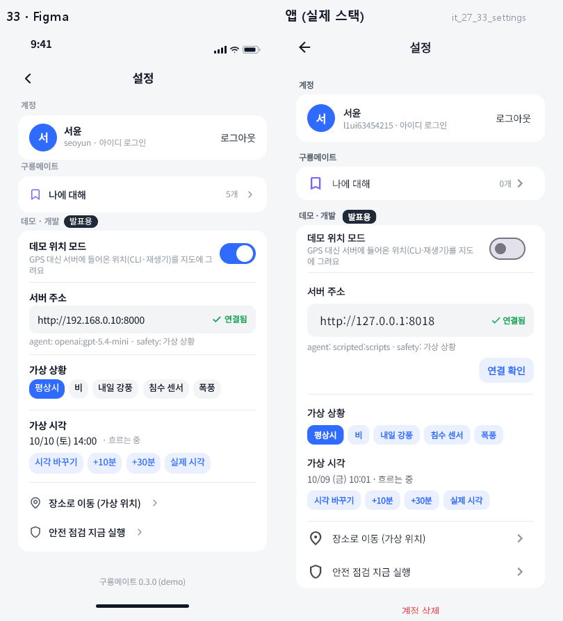
- 같음: 계정(아바타·이름·"아이디 로그인"·로그아웃), 나에 대해(n개), 데모·개발 "발표용" 그룹(데모 위치 모드, 서버 주소 + "✓ 연결됨" + agent·safety 줄, 가상 상황 칩, 가상 시각 칩, 장소로 이동, 안전 점검 지금 실행), 버전.
- 고침: 스위치 켜짐 색 Primary.
- 다름: [연결 확인] 버튼을 따로 둠(Figma 는 입력 칸만). 점검 실행이 404 `not_available`(AUTH_REQUIRED=true) 이면 행을 숨김. 계정 삭제(2단계) 줄 추가.

### 34 · 34-S1 · 35 — 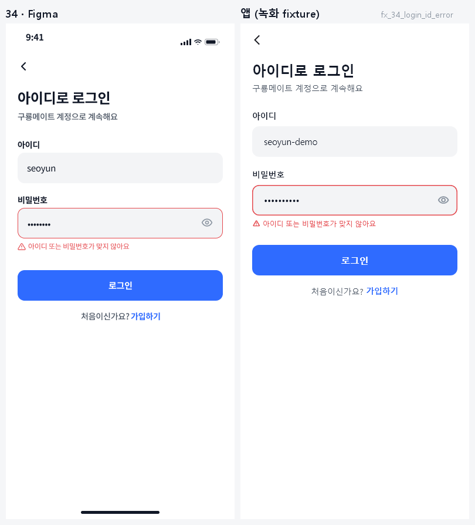 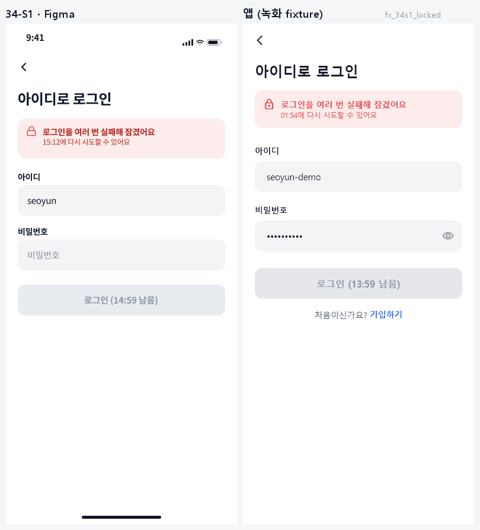 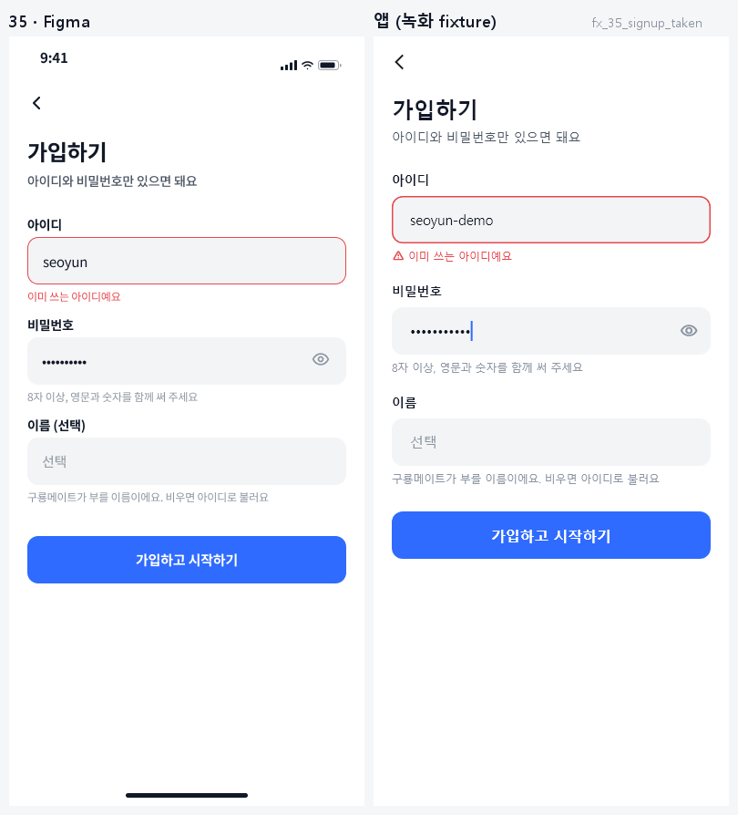
- 34: 오류 테두리 1.5px Danger + ⚠ 문구, 비밀번호 비움 — 일치.
- 고침(34-S1): 처음엔 잠김 박스를 필드 아래에 두고 Primary 40% 버튼이었는데, Figma 대로 **부제 자리에 두 줄 박스(굵은 제목 + "HH:MM에 다시 시도…")**, 버튼은 회색 "로그인 (mm:ss 남음)"으로 바꿨다.
- 고침(35): 서버 오류("이미 쓰는 아이디예요")가 **포커스·커서 이동만으로도 지워지던 버그** — 글자를 고쳤을 때만 지우도록.
- 35 캡처는 409 오류 상태(Figma 는 빈 상태).

### 36 Base Changed — 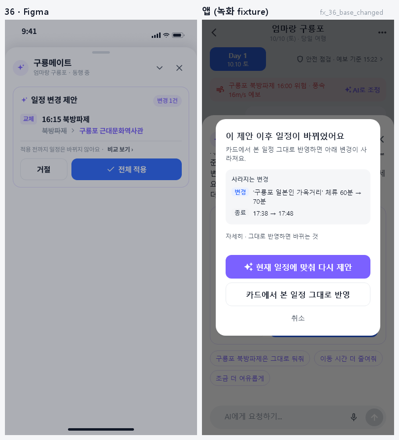
- 같음: Scrim + Dialog(제목·설명·사라지는 변경 박스·kind 배지 + 접두사 뗀 문구), 세로 버튼 [✨ 다시 제안 Purple] [그대로 반영 Secondary] [취소].
- 다름: Figma 는 확인창 뒤에 06 카드가 보이는 동행 장면, 캡처는 계획 모드. "자세히 · 그대로 반영하면 바뀌는 것"(overwrite_effect, P2) 접힌 줄 추가. progress_changed 는 덮어쓰기 없이 다시 제안만 있는 별도 확인창.

## 실제 Claude 확인 (claude-haiku-5-5, 계획 모드 3턴)

| 턴 | 단계 (서버 Step) | 카드 | 결과 |
|---|---|---|---|
| "엄마랑 구룡포 일정 짜줘. 어머니가 오래 걷기 힘드셔." | 장소 찾기 · 기억하기(어머니와 동행, 오래 걷기 힘드심) · 조건 반영(하루 도보 30분 이내) · 일정 조정 · 일정 검토 · 안전 확인 · 일정 검토 · 변경안 만들기 | 변경 제안 7건 | 승인 → 대게직판장·가옥거리·구룡포항·카페파도 |
| "카페는 바다가 보이는 곳으로 바꿔줘" | 장소 찾기 · 장소 정보 확인 | 없음 | 카페파도가 이미 바다 전망이라 바꾸지 않음 |
| "Day 1 날씨와 안전 확인해줘" | 안전 확인(위험 신호 없음) | 없음 | 맑음·바람 약함, 주의·위험 신호 없음 |

오류 없이 진행 단계(같은 id 갱신·접힘)·기억 칩·카드·승인이 그려졌다. 캡처: `l1/app/claude_*.png`.

## 테스트

- `flutter test` — 36개 통과, 6개 건너뜀(live 3 · capture 3) (SSE 재생·카드 동작·상태별 위젯·F11·401 refresh, LLM 호출 없음).
- `integration_test/app_flow_test.dart` — 각본 LLM 스택(:8018)에서 F1·F2 + 25~29·31~33 통과 (캡처 28장).
- `integration_test/claude_check_test.dart` — 실제 Claude 3턴 통과.
