# L2 Figma 대조 — 동행 모드 (feat/app-l2, 2026-10-10)

화면마다 **Figma 프레임 | 앱 캡처**를 나란히 둔 이미지(`l2/cmp/`, `python docs/app/review/l2/make_cmp.py`)와 다른 점, 고친 것 또는 그대로 둔 이유.

| 캡처 | 어떻게 만들었나 |
|---|---|
| `l2/figma/*.png` | figma-bridge `save_screenshots` (파일 「GuryongMate」 Page 1 의 11~24·30, 14-S1·S2·S3·16-S1·21-S1, Components_Companion, States_Feedback, scale 1) |
| `l2/flows/*.png` | 「Flows — 동행 모드」 F3~F7 흐름도 |
| `l2/app/fx_*.png` | `test/capture_trip_test.dart` — 여행 재생 fixture(`trip/scene2·3·4`)와 f3~f6 을 데모 위치 모드처럼 흘려 Figma 와 같은 장면을 그림. 맑은 고딕(Noto Sans KR 보다 글자 폭이 조금 넓음), 지도 타일은 네트워크가 없어 비어 있고 routing 이 없어 구간은 직선(점선) |
| `l2/app/it_*.png` | `integration_test/trip_flow_test.dart` — Windows 앱(데모 위치 모드)을 **각본 LLM 스택**(:8020, scripted + safety mock)에 붙이고, 서버 쪽은 테스트가 띄운 `cli.py trip replay new scene2_arrival / scene3_delay / scene4_safety --speed 10·20·20` 로 위치·시각·안전 상황을 넣은 화면 |
| `l2/app/claude_*.png` | 실제 Claude 확인 (장면 ③ 선제 턴 + 조건 대화, 장면 ② 장소 질문) |

Figma 의 문구(바다뷰 카페, "늦어진 30분을 흡수해요", "16~18시 풍속 최대 15m/s" 등)는 예시 값이다. 앱은 같은 자리에 **녹화/실제 데이터**(서버 `message`, LLM 답변, 제안 `changes`)를 그린다.
아래 "다른 점"은 데이터 차이가 아닌 **구조·스타일** 차이만 적는다.

## 요약

| 화면 | 결과 | 남은 차이 (이유) |
|---|---|---|
| 11 Trip Start | 일치 | 노트 준비 안 된 곳 안내 줄 추가 (명세 11). 자동 표시는 시간 조건만 (계획 모드에서 위치 없음) |
| 12 Not Trip Day | 일치 | — |
| 13 Location Permission | 일치 | — |
| 14 Today | 거의 일치 | 패널 맨 아래 "여행 종료"(명세 14). fx 는 routing 없이 직선 |
| 14-S1 · 14-S2 | 일치 | 14-S2 "지금 위치에서 도보 n분"은 위치·routing 이 있을 때만 |
| 14-S3 | 일치 | 미리보기에 × (안전은 닫을 때까지), 서버 message 라 3줄 |
| 15 Moving | 거의 일치 | [도착했어요](P2) 없음 (명세: 데모 빌드에서 숨김) |
| 16 · 16-S1 | 일치 | 16-S1 은 카드 상태를 캡처 (Figma 는 누른 뒤 시트) |
| 17 Guide Note | 일치 | 동행자 이름은 메모리 companion 이 있을 때만 |
| 18 Docent Chat | 일치 | 출처 칩 없음 (gaps b6) |
| 19 · 20 | 일치 | 고침: 선제 표시 줄 잘림. 입력창 문구 "구룡메이트에게 요청하기…" |
| 21-S1 | 일치 | 장면 ③ 녹화에 안전 점검이 없어 "확인 못 함" |
| 22 | 일치 | 근거 제목의 시각 = 이벤트 시각 (발표 시각 없음) |
| 23 | 일치 | 고침: 접힌 띠가 알림 버튼을 가림 → Pill 아래로, push 화면에선 숨김 |
| 24 | 일치 | 제목이 서버 message 라 길다 (2줄) |
| 30 | 일치 | 고침: 도운 순간 문구를 changes 로 짧게, 위험 구역 한 줄로. 요약 API 없음 (b8, b27) |

## 화면별

### 11 Trip Start — 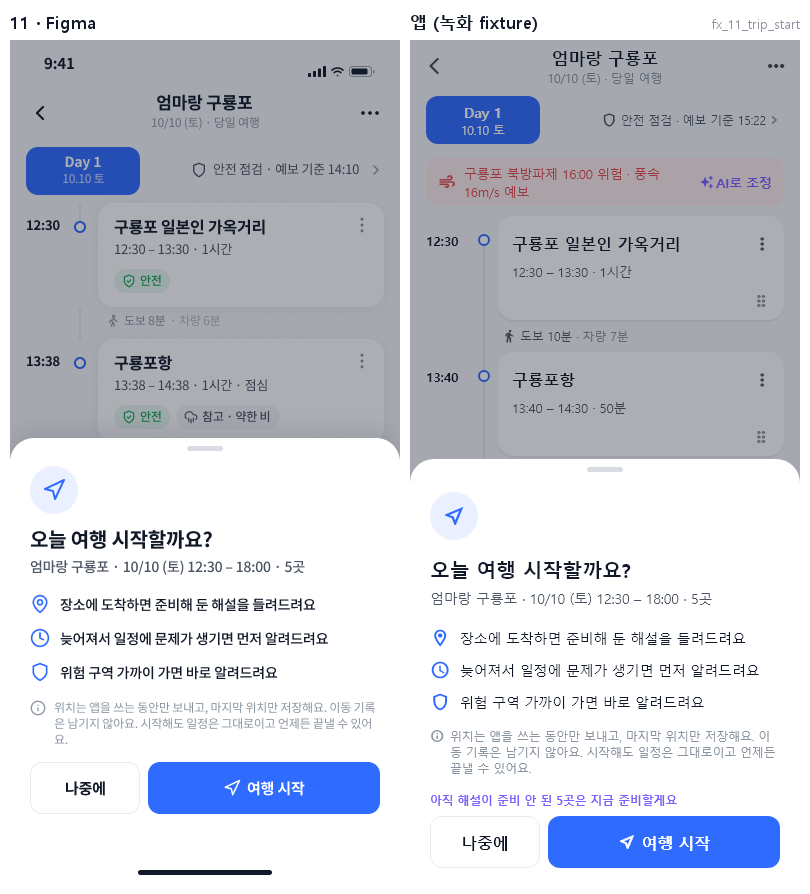
- 같음: Scrim 위 시트(r24, Grabber), 아이콘 48, 제목 "오늘 여행 시작할까요?", 요약 "계획 · 10/10 (토) 12:30 – 18:00 · n곳", 하는 일 3줄, 개인정보 안내, [나중에 110][여행 시작].
- 추가(명세 11 선택 줄): "아직 해설이 준비 안 된 n곳은 지금 준비할게요" (Purple 12). 여러 날이면 제목 아래 "n일차".
- 자동 표시: 여행일 + 첫 일정 1시간 전 이후 그날 한 번 (SharedPreferences). "구룡포 3km 안" 조건은 계획 모드에서 위치를 받지 않아 보지 않는다.

### 12 Not Trip Day — 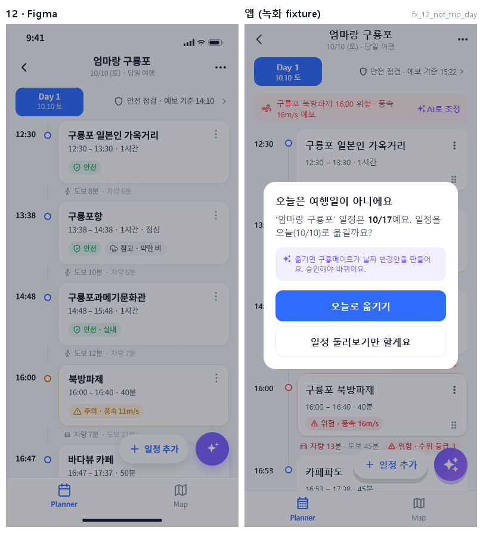
- 같음: Dialog 326 r20, 제목, 본문(날짜 Bold), AI 안내 박스(#F2EFFF), 세로 버튼 [오늘로 옮기기][일정 둘러보기만 할게요].
- 동작: 옮기기 → AI 시트에 "일정을 오늘(MM/DD)로 옮겨줘" → 제안 승인으로 시작일이 오늘이 되면 11 을 다시 띄운다. 지난 여행이면 "지난 여행이에요" + [닫기].

### 13 Location Permission — 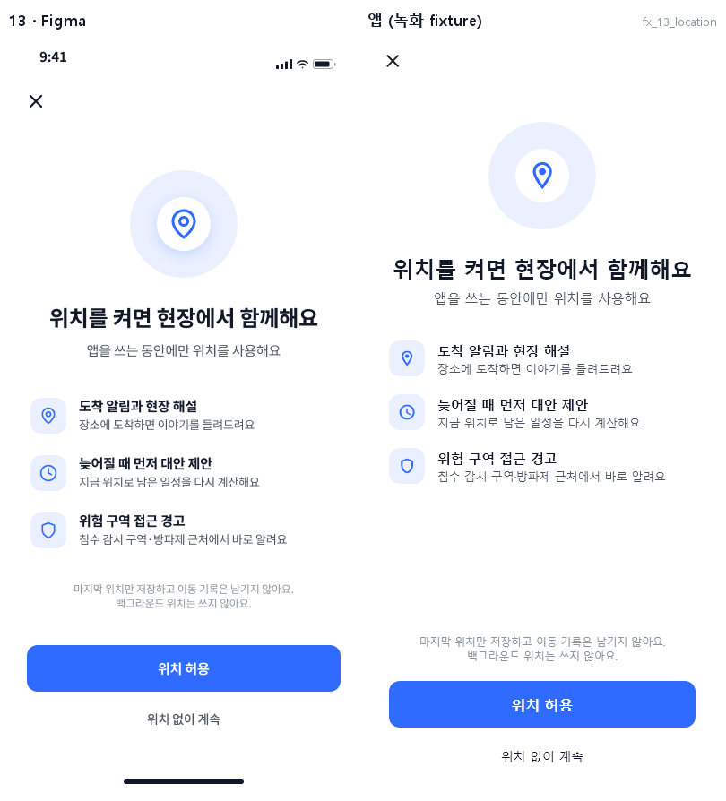
- 같음: 닫기 · 120 원 일러스트 · 제목 24 · 부제 · 3행(아이콘 박스 40 r12) · 개인정보 12 · [위치 허용] · [위치 없이 계속].
- 데모 위치 모드면 건너뛴다. 거부해도 시작은 계속 → 14-S1.

### 14 Today — 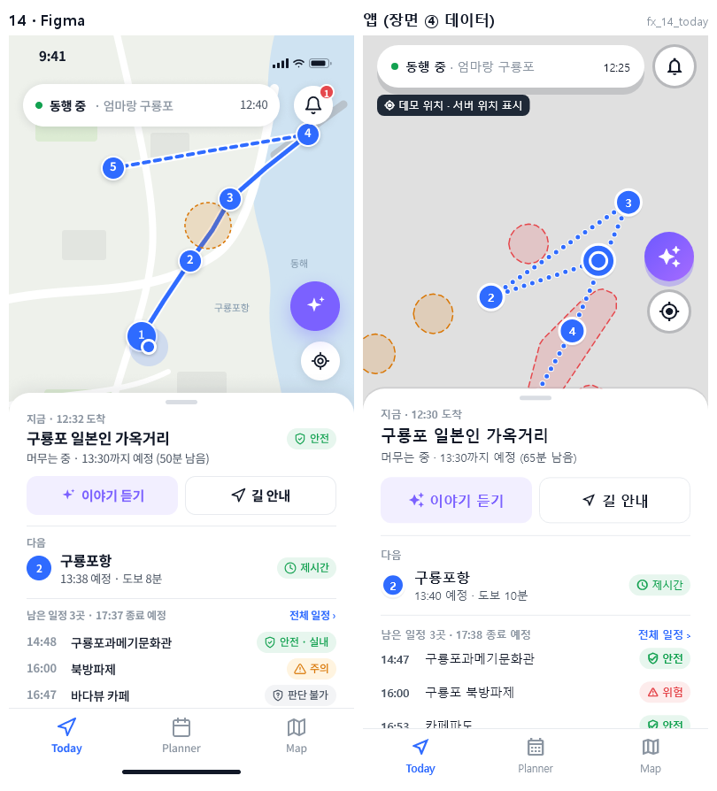 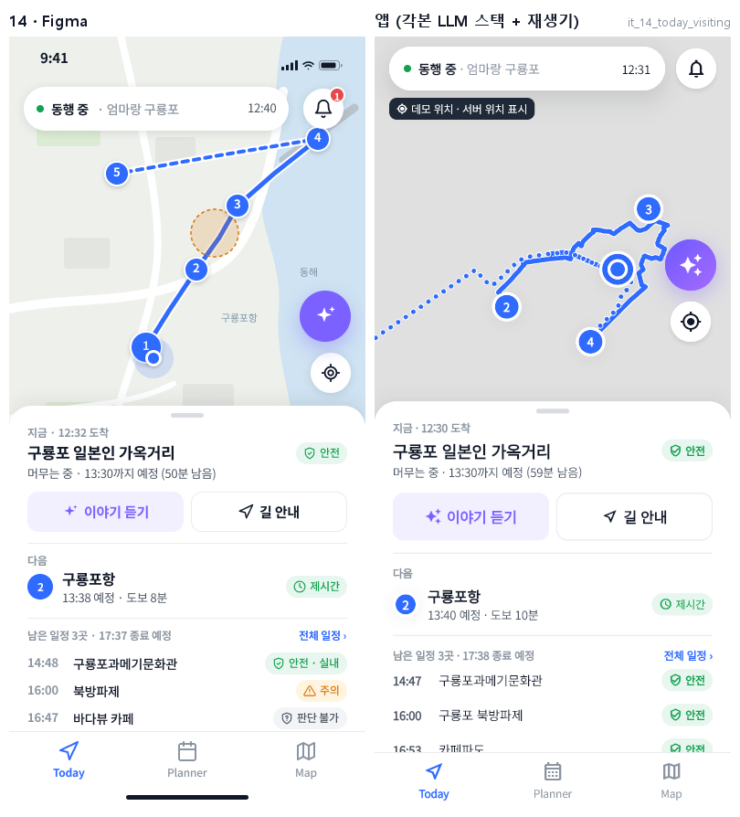
- 같음: 지도 위 Trip Pill(● 동행 중 · 계획명 · 서버 시각), 알림 버튼(안 본 수 배지), AI FAB(Has Suggestion 점), 현재 위치 버튼, 패널(지금 · 다음 + ETA 칩 · 남은 일정 + 위험 배지 · 전체 일정 ›), 하단 탭 Today · Planner · Map.
- 다름: 패널 맨 아래 "여행 종료" 텍스트 버튼(명세 14 패널 4). 지금 줄의 "n분 남음"은 실제 도착 + 체류 기준 (계획 end_at 이 아니라 진행 기준).
- 다름: 지도 경로는 구간마다 `POST /routing/route {hazards:"report"}` (명세는 수단이 바뀌는 지점에서 나눈 여러 번 — 같은 결과를 구간 캐시로). fx 캡처는 routing 이 없어 직선 점선.
- 다름: Pill 시각은 서버 `now` + 흐른 시간. 녹화 재생의 state.now 는 위치 recorded_at 보다 늦게 따라와 fx 에서는 12:25 로 보인다 (데이터).

### 14-S1 위치 꺼짐 + 오프라인 — 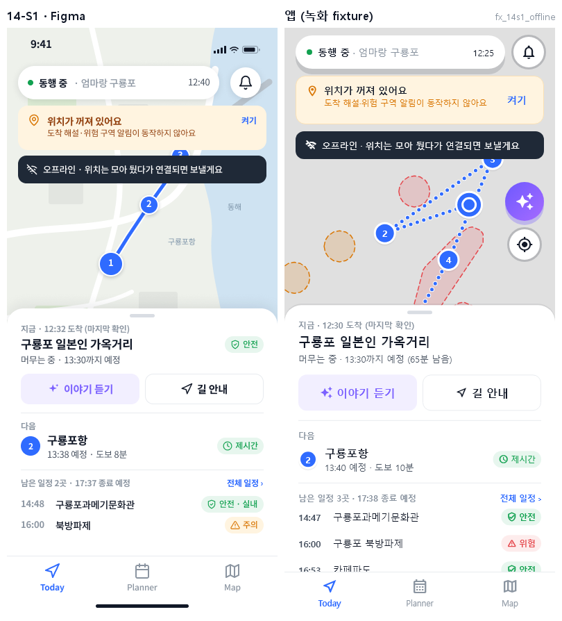
- 같음: Amber 배너 "위치가 꺼져 있어요 · 도착 해설·위험 구역 알림이 동작하지 않아요 [켜기]", Dark 띠 "오프라인 · 위치는 모아 뒀다가 연결되면 보낼게요", 지금 caption "(마지막 확인)".
- [켜기]: 다시 요청, 영구 거부·위치 서비스 꺼짐이면 OS 설정 (geolocator).

### 14-S2 첫 장소 전 + 데모 위치 — 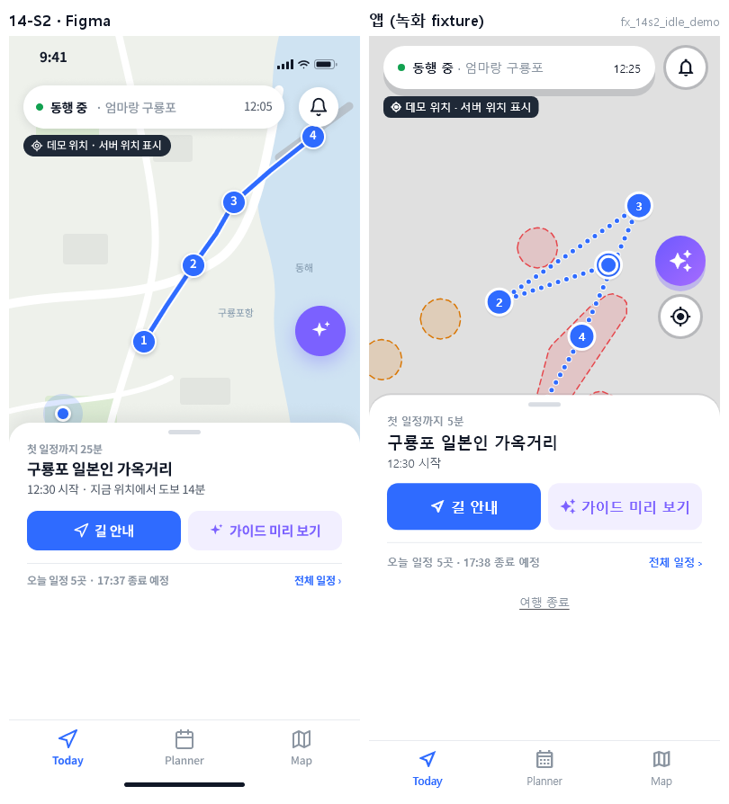
- 같음: "데모 위치 · 서버 위치 표시" 칩, "첫 일정까지 n분", 첫 장소, [길 안내](Primary) [가이드 미리 보기](AI Soft), "오늘 일정 n곳 · 종료 예정 · 전체 일정 ›".
- "지금 위치에서 도보 n분"은 위치가 있고 routing 이 될 때만 (fx 는 routing 이 없어 생략).

### 14-S3 대화 밖 선제 알림 — 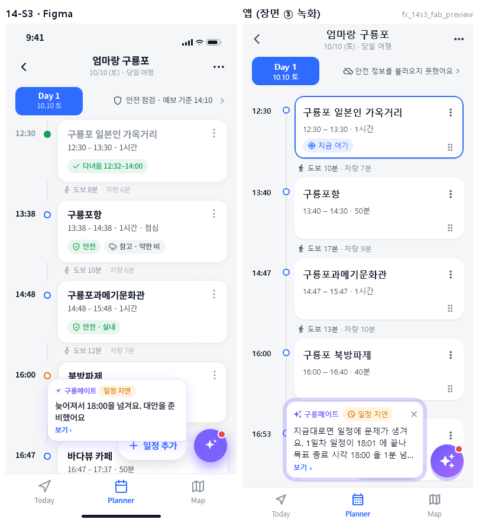 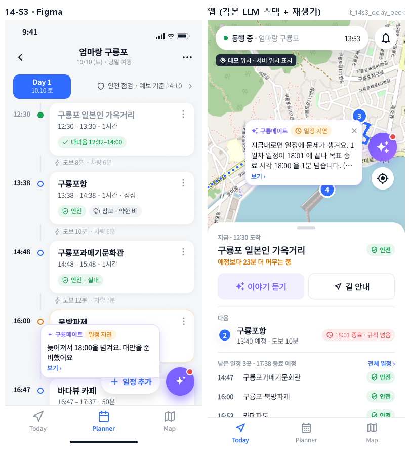
- 같음: FAB 빨간 점, 미리보기 말풍선 232(✨ 구룡메이트 + 이벤트 칩 + 서버 message + 보기 ›), 8초 뒤 접힘(점만), 안전은 닫을 때까지.
- 다름: 말풍선에 × 를 두었다(명세 "사용자가 닫을 때까지" 의 닫기). 문구는 서버 `message` 라 Figma 예시보다 길어 3줄에서 자른다.
- push 화면(17·24 등)에서는 같은 미리보기를 상단 배너로.

### 15 Today Moving — 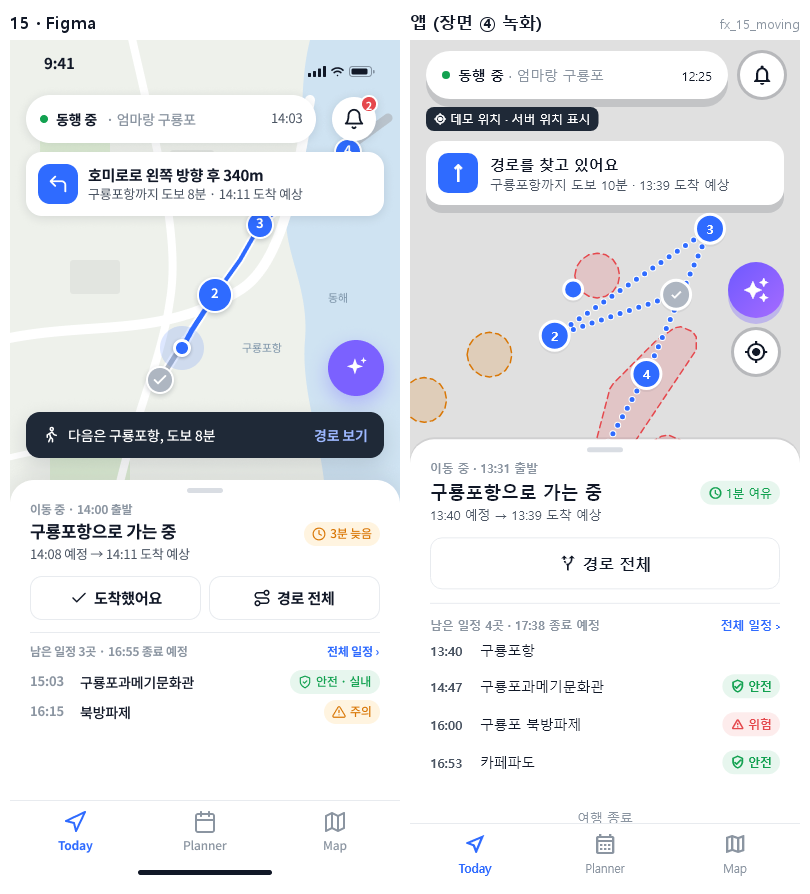
- 같음: 상단 길 안내 카드(회전 아이콘 · steps 안내 한 줄 · "{장소}까지 도보 n분 · HH:MM 도착 예상"), 우회 시 Amber 보조 줄, 패널 "이동 중 · HH:MM 출발 / {다음}으로 가는 중 / 예정 → 도착 예상 / ETA 칩".
- 다름: [도착했어요](P2) 는 넣지 않았다 (명세 15: 데모 빌드에서는 숨김). 출발 토스트는 Dark 토스트(4초)로 패널 위에.
- fx 캡처는 routing 이 없어 안내 카드가 "{장소} 방향"(명세 15 estimate 엣지).

### 16 Arrival Docent — 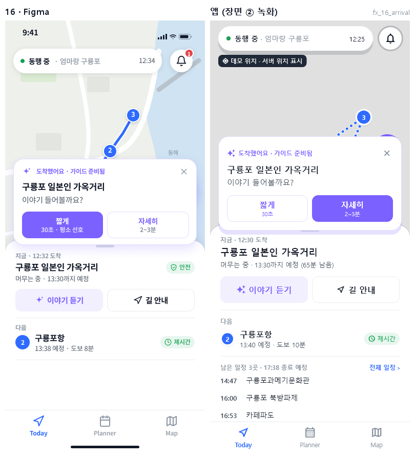 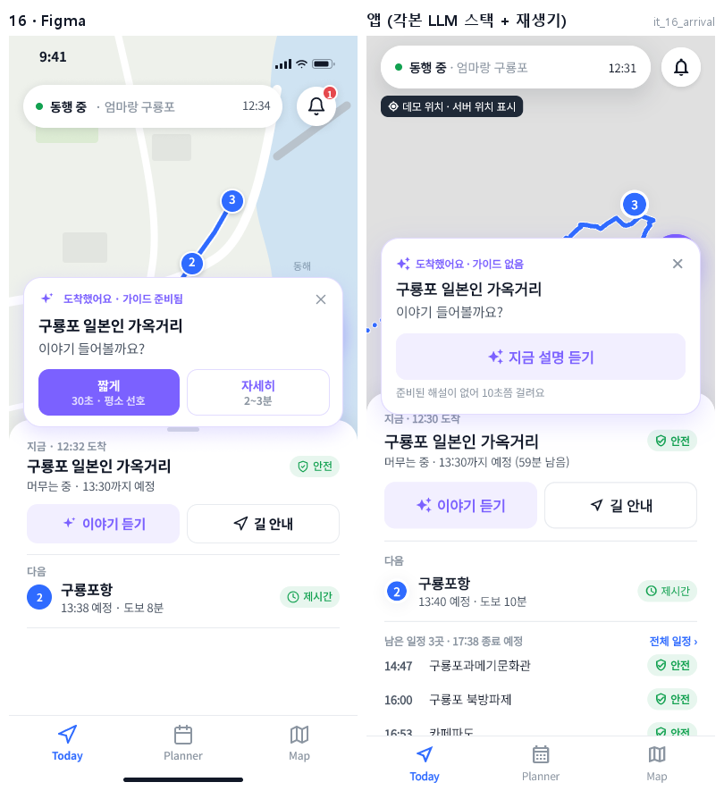
- 같음: 카드 358 r20 #E2DCFF 테두리 · Purple 그림자, "✨ 도착했어요 · 가이드 준비됨" + ×, 장소명, "이야기 들어볼까요?", [짧게 / 30초][자세히 / 2~3분] — style_length 가 short 면 [짧게] Purple 채움 + "평소 선호", 없거나 long 이면 [자세히] 채움 (명세 16 규칙).
- 다름: 장면 ② 첫 도착은 선호가 없어 [자세히]가 채워져 있다 (Figma 는 "더 짧게" 이후 장면). 위젯 테스트로 "더 짧게" 뒤 [짧게] "평소 선호" 확인.
- 시트가 열려 있으면 대화 맨 아래 로컬 카드로, 3단계가 오면 "해설 듣기" 칩으로 접힌다.

### 16-S1 노트 없음 — 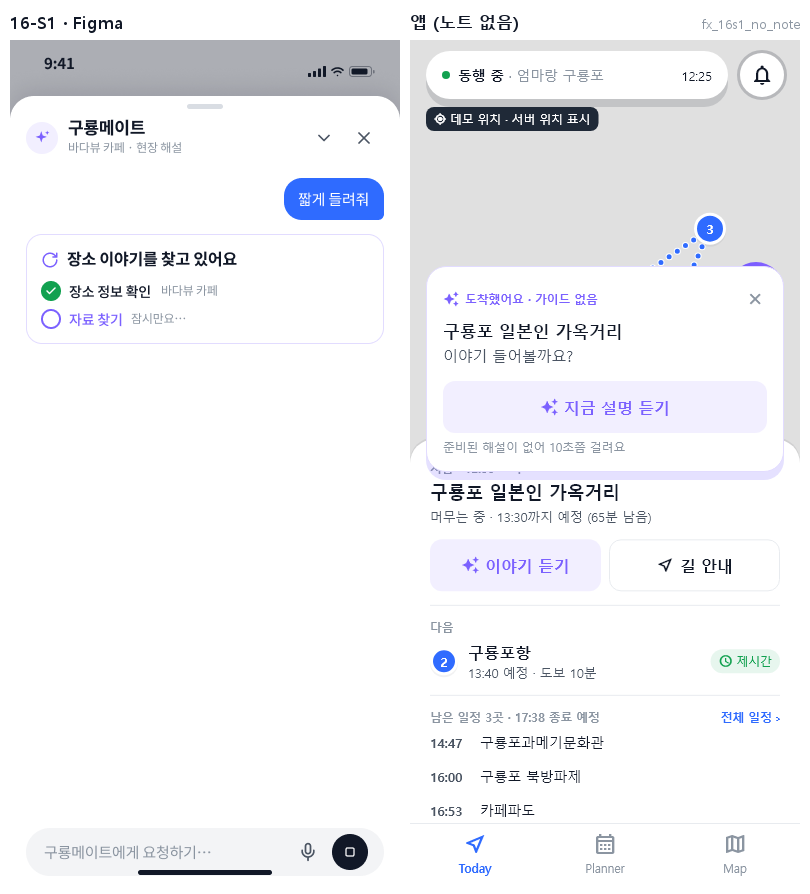
- Figma 16-S1 은 [지금 설명 듣기] 를 누른 뒤의 AI 시트(진행 단계)다. 앱은 카드 상태(가이드 없음 · [✨ 지금 설명 듣기] · "준비된 해설이 없어 10초쯤 걸려요")를 캡처했고, 누르면 같은 AI 시트가 "{장소} 짧게 설명해줘" 로 열린다 (헤더 "{장소} · 현장 해설").

### 17 Guide Note — 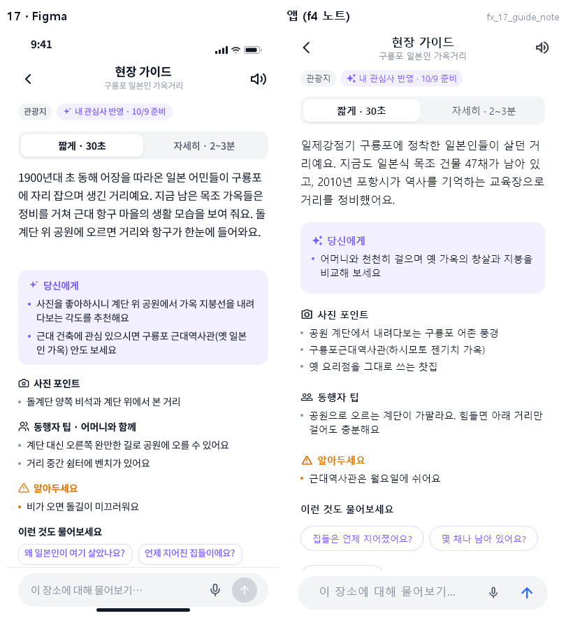
- 같음: App Bar(현장 가이드 / 장소명 / 🔊 준비 중), 태그(분류 · ✨ 내 관심사 반영 · MM/DD 준비), Segment, 본문 16/26, 당신에게(#F2EFFF), 사진 포인트, 동행자 팁, 알아두세요(Amber), 이런 것도 물어보세요(Purple 칩), 출처 칩(공식·언론·방문 후기), 하단 입력.
- 다름: 동행자 팁 제목의 "· 어머니와 함께"는 메모리 companion 이 있을 때만 (f4 녹화에는 없음).

### 18 Docent Chat — 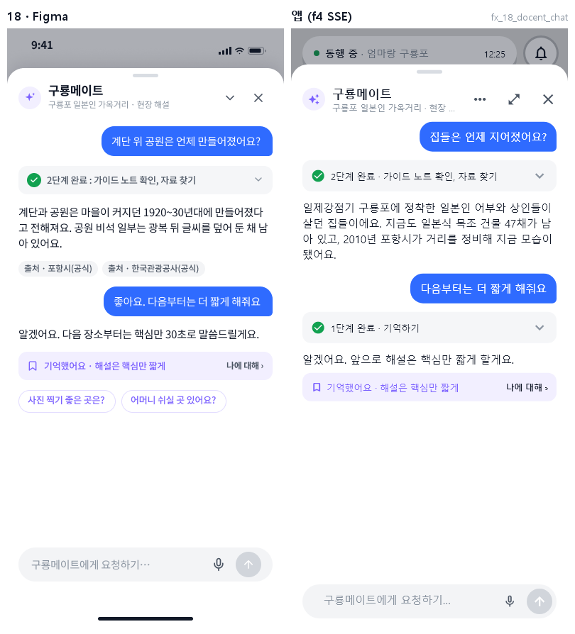 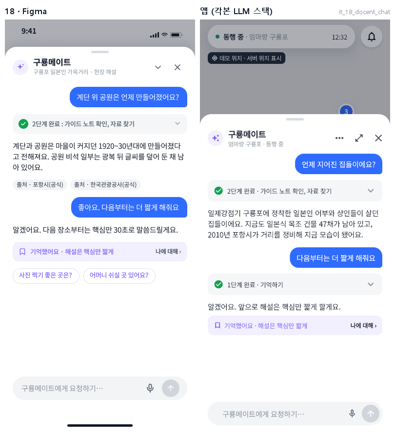
- 같음: 헤더 "{장소} · 현장 해설", 사용자 말풍선 → 접힌 단계 요약(가이드 노트 확인, 자료 찾기) → 답변 → "더 짧게" → 기억 칩 "기억했어요 · 해설은 핵심만 짧게 · 나에 대해 ›"(31).
- 다름: 출처 칩 없음 (SSE 에 출처 없음, gaps b6). 헤더 오른쪽 아이콘은 L1 시트 그대로(⋯ · 크기 · 닫기).
- 승인 대기 제안이 있을 때 서버가 붙이는 "아직 승인 대기 중인 변경안이 있어요." 는 떼어 Purple 안내 줄 + "제안 보기 ›"(그 카드로 스크롤).

### 19 Proactive Delay — 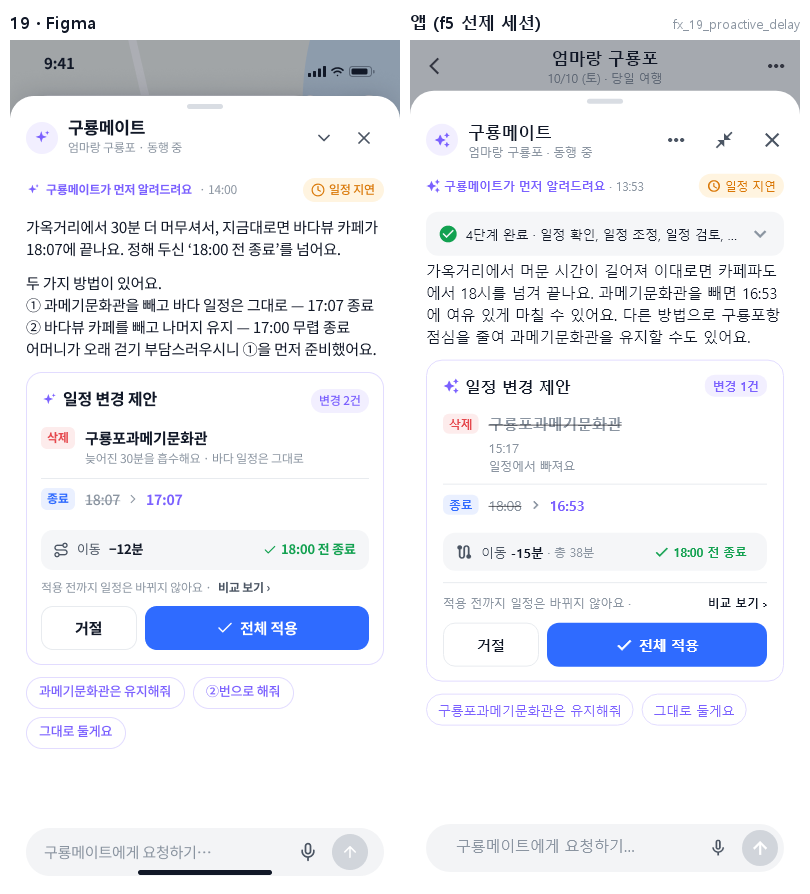 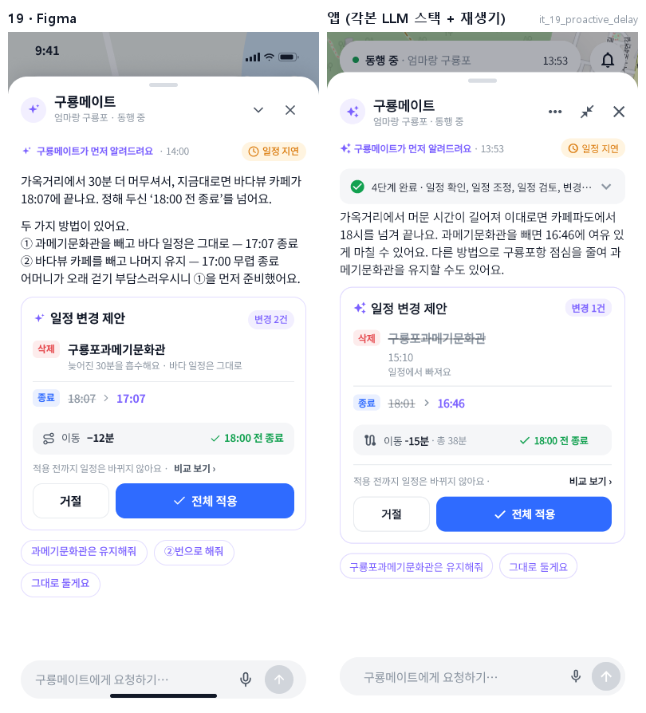
- 같음: 헤더 "{계획} · 동행 중", 선제 표시 줄(✨ 구룡메이트가 먼저 알려드려요 · HH:MM + Amber "일정 지연"), 답변, 제안 카드 + **종료 행**(이전 취소선 › 이후 Purple) + 영향 박스("18:00 전 종료 ✓"), "적용 전까지… 비교 보기 ›", [거절][전체 적용], 후속 칩("{빠지는 곳}은 유지해줘" · "②번으로 해줘"(답변에 ②가 있을 때) · "그대로 둘게요").
- 고침: 선제 표시 줄이 Spacer 와 나눠 가져 "구룡메이트가 먼…"으로 잘리던 것 → 표시 줄 텍스트가 남는 폭을 모두 쓰게.
- 다름: 선제 턴의 단계 요약 줄(접힘)이 답변 위에 있다 (서버 steps). 입력창 문구 "구룡메이트에게 요청하기…"(Figma) 로 바꿨다 (L1 은 "AI에게 요청하기...").

### 20 Proposal Revised — 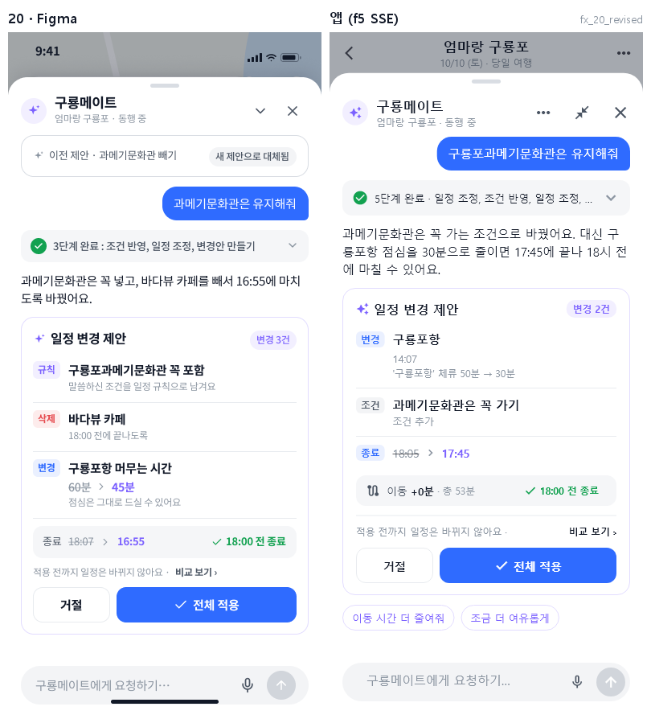
- 같음: 이전 카드 접힘("새 제안으로 대체됨"), 사용자 말풍선, 단계 요약, 답변, 새 카드(규칙/조건 · 변경 · 종료 행 · 18:00 전 종료).
- 다름: 규칙 배지는 L1 표기 "조건"(Figma "규칙"), 문구는 서버 change(gaps b21).

### 21-S1 Compare (지연) — 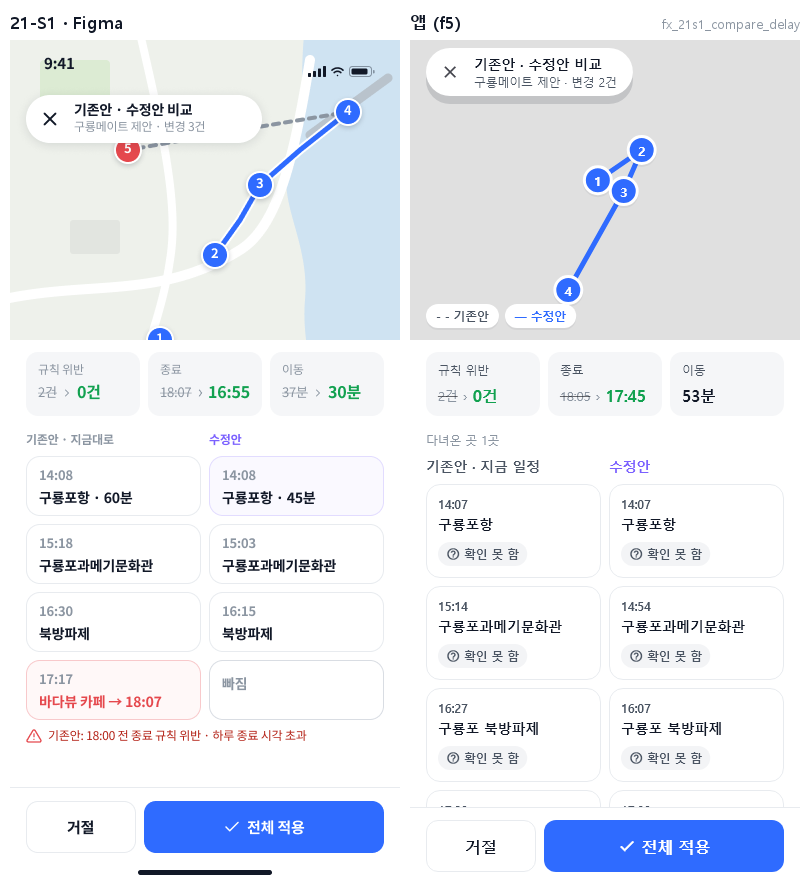
- 같음: 지표 첫 칸 "규칙 위반 2건 → 0건"(안전 변화가 없으면), 종료, 이동, "다녀온 곳 n곳", 두 열 타임라인.
- 다름: 장면 ③ 녹화에는 안전 점검이 없어 배지가 "확인 못 함" (명세 21 상태).

### 22 Proactive Safety — 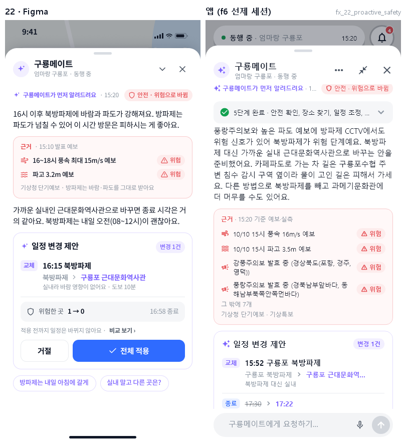 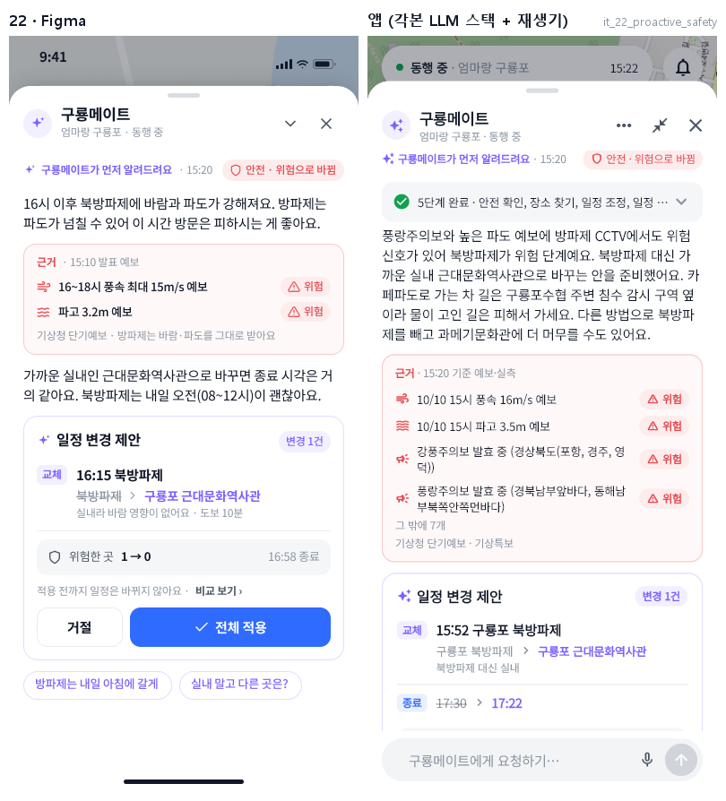
- 같음: 선제 표시 줄 + Red "안전 · 위험으로 바뀜", 답변, **근거 박스**(#FFF8F8 · 아이콘 + reason + 단계 배지 · 출처 줄 중복 없이), 교체 카드, **영향 박스 "위험한 곳 1 → 0 · HH:MM 종료"**(`POST …/safety/preview`), 후속 칩("{장소}은 다른 시간에 갈게" · "실내 말고 다른 곳은?").
- 다름: 근거 제목 "근거 · HH:MM 기준 예보·실측"(이벤트 시각, payload 에 발표 시각이 없음). 근거는 caution·danger 4개까지 + "그 밖에 n개".

### 23 Hazard Alert — 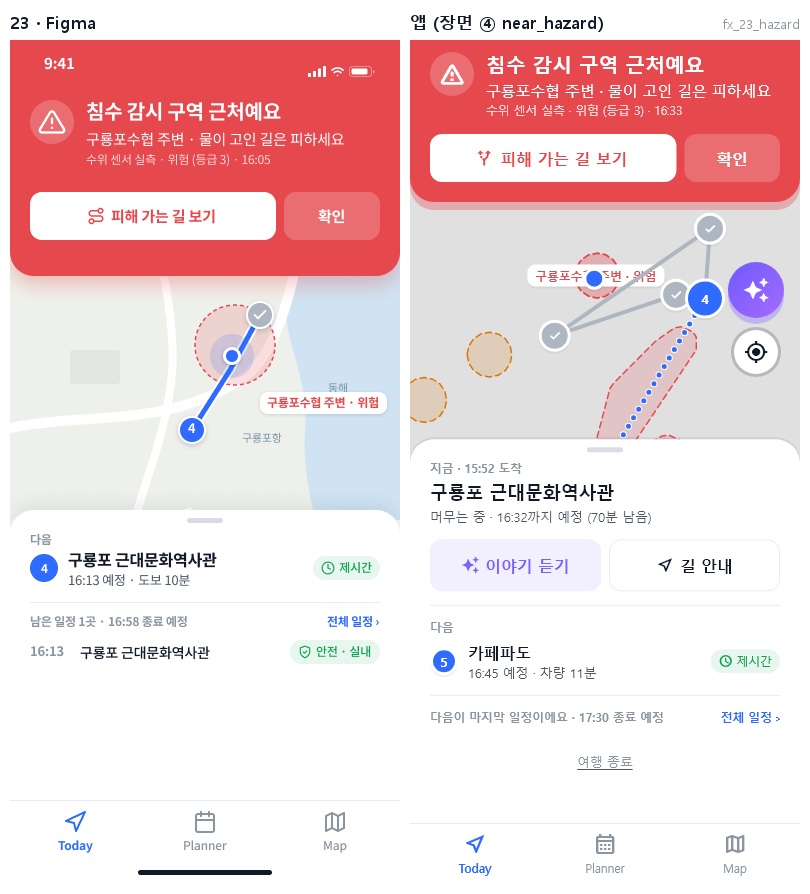 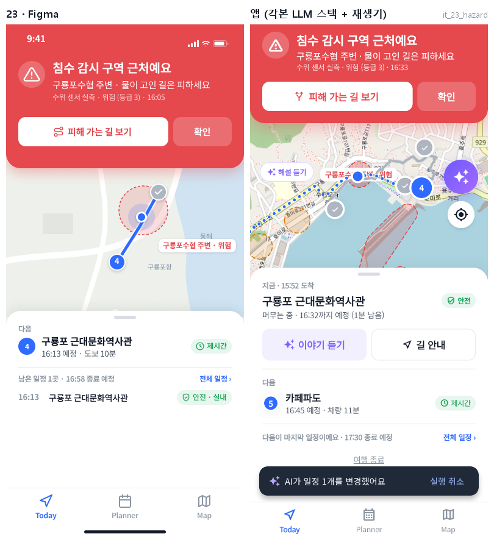
- 같음: 상단 Red 패널(하단 r24, 그림자), 아이콘 44, 제목(구역 종류), 본문 "{구역} · {행동 지침}"(서버 message), 근거 "수위 센서 실측 · 위험 (등급 3) · HH:MM", [피해 가는 길 보기][확인], 지도 그 구역 라벨만, 진동 + 알림음.
- [확인] → 32 높이 Red 띠("위험 구역 근처 · {구역}"). 고침: 처음엔 띠를 상태바 바로 아래 두어 알림 버튼을 가렸다 → Pill·앱 바 아래(상단 + 64)로. push 화면에서는 띠를 숨긴다(목록에 남음).
- 최상단: MaterialApp.builder 의 오버레이라 AI 시트·다이얼로그 위에서도 보인다 (위젯 테스트로 확인).
- [피해 가는 길 보기] → 우회 시트(28): 지금 위치 → 다음 장소 `hazards:"avoid", steps:true` 와 원래 길 비교.

### 24 Event Inbox — 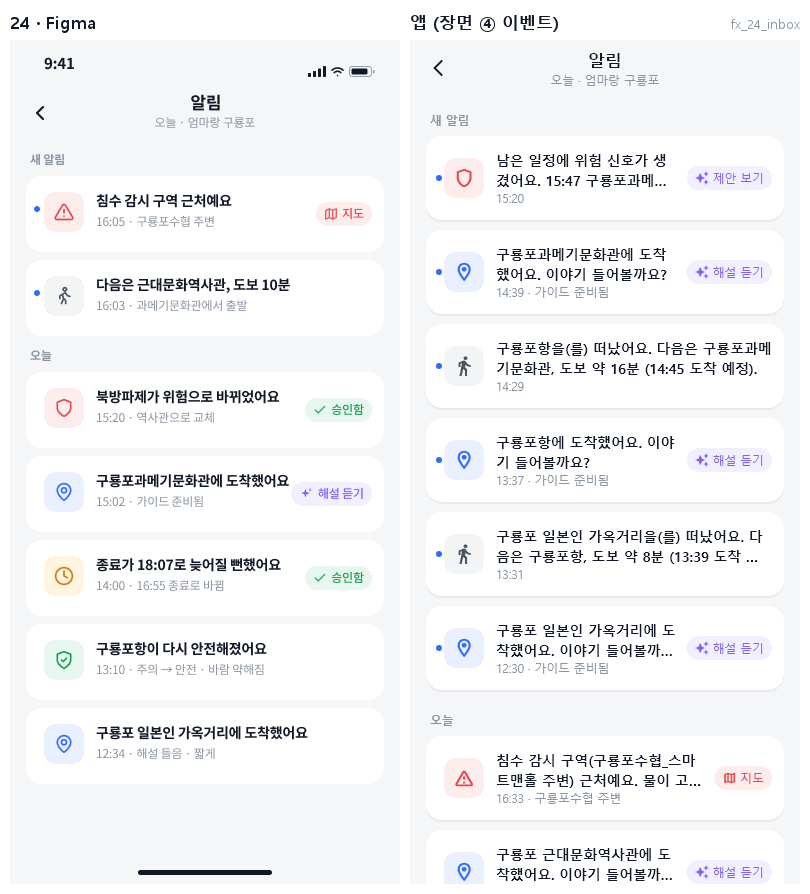
- 같음: App Bar(알림 / 오늘 · 계획), "새 알림"/"오늘" 그룹, 행(아이콘 박스 40 타입 색 · 제목 · "HH:MM · 상태" · 동작 칩 · 새 알림 점), 제안 상태 칩(제안 보기/승인함/거절함/새 제안으로 바뀜), [지도], [해설 듣기]/"해설 들음 · 짧게".
- 다름: 제목은 서버 `message` 라 Figma 의 짧은 제목보다 길다(2줄). 보인 행은 seen 처리.

### 30 Trip End — 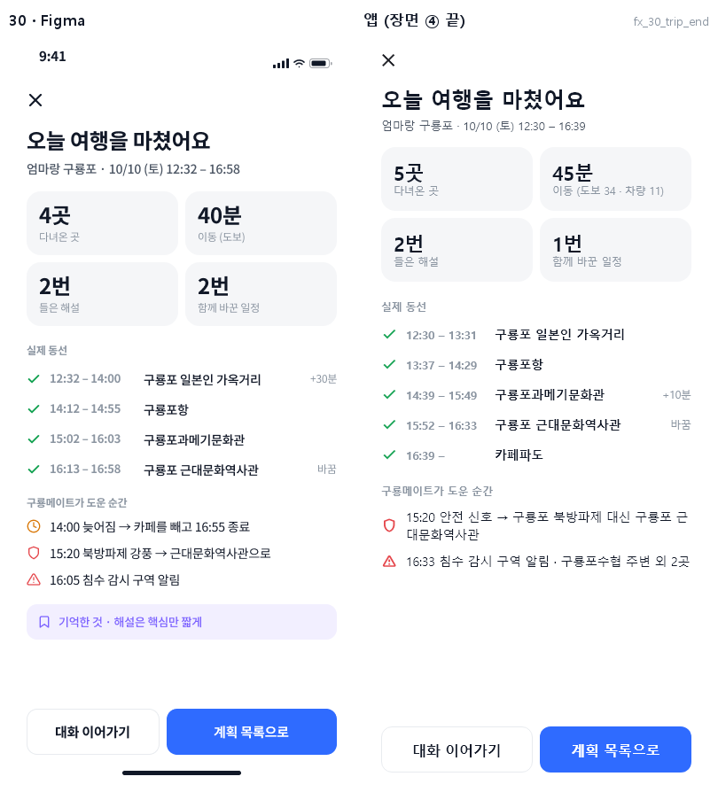
- 같음: 닫기, 제목, "계획 · MM/DD (요일) 첫 도착 – 마지막 완료", 지표 2×2, 실제 동선(✓ · 실제 시각 · +n분/바꿈), 구룡메이트가 도운 순간, 기억한 것 칩, [대화 이어가기][계획 목록으로].
- 고침: 처음엔 도운 순간이 이벤트 문구 그대로(위험 구역 3줄, 제안 요약 첫 문장)라 길었다 → 제안 결과는 changes 로 "북방파제 대신 근대문화역사관"·"과메기문화관 빼기, 16:53 종료", 위험 구역은 한 줄로 묶음("… 외 2곳").
- 요약 API 가 없어 앱이 계산 (gaps b8, b27: 실제 시각/가상 시각 차이).

## 실제 Claude 확인

`integration_test/trip_claude_check_test.dart` — 스택의 agent 만 `AGENT_PROVIDER=claude`(claude-haiku-5-5)로 바꿔 짧게 확인. 재생기 `--speed 0`, 재생 뒤 바로 여행 종료(백그라운드 틱이 선제 턴을 더 보내지 않게).

| 장면 | 사용자 | 단계 (서버 Step) | 답변 (요약) | 카드 |
|---|---|---|---|---|
| ③ 선제 턴 (delay 13:53) | — (이벤트) | 일정 조정 → 일정 검토(문제 없음) → 변경안 만들기 | 구룡포항 도착이 23분 늦어 카페파도가 18:01 에 끝나 18:00 규칙을 넘음 · 과메기문화관 60→50분 추천(17:55) · "다른 방법으로 북방파제 체류를 줄이거나 카페파도를 빼는 것도" (세 문장 형식) | #26 변경 1건, 종료 18:05 → 17:55 |
| ③ 조건 대화 | 과메기문화관은 유지해줘 | 조건 반영(must_include) → 일정 조정 → 일정 검토 → 변경안 만들기 | 과메기문화관 60분 유지, 대신 북방파제 40→30분, 17:55 종료 · 다른 방법 한 줄 | #27 변경 2건(규칙 + 북방파제), 이전 #26 대체 |
| ② 장소 질문 | 언제 지어진 집들이에요? | 가이드 노트 확인(노트 없음) → 자료 찾기(근거 4개) | 건축 연도는 자료에 없다고 밝히고, 1883년 이후 일본인 정착·목조 건물 47채·2010년 포항시 정비 (지어내지 않음) | 없음 |

- 앱 쪽: 선제 표시 줄·Amber 칩·종료 행·"18:00 전 종료"·후속 칩, 조건 대화 뒤 이전 카드 접힘, 시트가 열린 채 다음 장소에 도착하면 대화 맨 아래 로컬 도착 카드(16)가 붙는 것까지 각본 LLM 과 같은 모양으로 그려졌다.
- Claude 의 "조건" 줄 문구에 코드 표기(`must_include {'place_id': …}`)가 섞여 앱이 괄호 안 사람 말("사용자가 과메기문화관은 유지하라고 요청")만 쓴다 (gaps b21 그대로).
- 캡처: `l2/app/claude_14s3_delay_peek.png`, `claude_19_proactive_delay.png`, `claude_20_revised.png`, `claude_16_arrival.png`, `claude_18_place_question.png`.

## 테스트

- `flutter test` — **51개 통과**, 12개 건너뜀 (live 3 · L1 capture 3 · L2 capture 6). L2 추가 15개, LLM 호출 없음:
  - `trip_screens_test.dart` (6): F3 11→12(409)→시작→14 Today 탭→여행 종료→30 · 13 거부→14-S1→[켜기] · 장면 ② 16→17→18 기억 칩 · 16 "평소 선호"·16-S1 · 장면 ③ 가벼운 지연→queued(2초 폴링)→14-S3→19→20→21-S1→승인 · 장면 ④ 22 근거·1→0 → 23 최상단(시트 위)·띠 → 24.
  - `trip_logic_test.dart` (9): 우선순위(카드→칩, 안전>지연, 경고 따로, 지연 8초 접힘·안전 유지, 닫으면 다음 · 카드 복귀), 토스트(4초·같은 종류는 마지막), 같은 id 한 번·쌓인 0~1단계는 목록만, 폴링 5초·push 10초·선제 대기 2초(60초 뒤 5초)·복귀 즉시, state 15초/데모 5초, 위치 30m·45초·서버 시계 recorded_at, 오프라인 130점 → 100+30 points, trip_not_active, 앱 GPS→위치 응답 이벤트 즉시·네트워크 끊김 14-S1→points.
- `integration_test/trip_flow_test.dart` — 각본 LLM 스택(:8020)에서 장면 ②③④ 통과 (약 20분, 재생기 기대 3·4·6개 모두 통과), 캡처 18장 `l2/app/it_*.png`.
  - 고친 것(테스트): 재생기 출력이 파이프에서 버퍼링돼 시작을 못 봄 → `python -u`. 오버레이(미리보기·경고·카드)는 스크롤 없이 바로 누름.
  - 실제 앱 동작으로 확인한 것: 도착 카드가 Today FAB 위에 뜬다(Figma 16 과 같은 배치) · 재생 중 다음 위험 구역 경고가 알림 화면의 앱 바를 덮는다(최상단 규칙).
  - it 캡처 중 `it_15_moving`·`it_30_trip_end` 는 아래 두 수정 전 화면이다: 출발 토스트가 이동 패널을 가림 → Today 패널 위(상단 + 328)로, 30 의 결과 줄이 서버 change 문구 그대로 → 장소 이름만. fx 캡처는 수정 후.
- `integration_test/trip_claude_check_test.dart` — 실제 Claude (위 표). `--dart-define=ONLY=scene2|scene3` 로 한 장면만.
