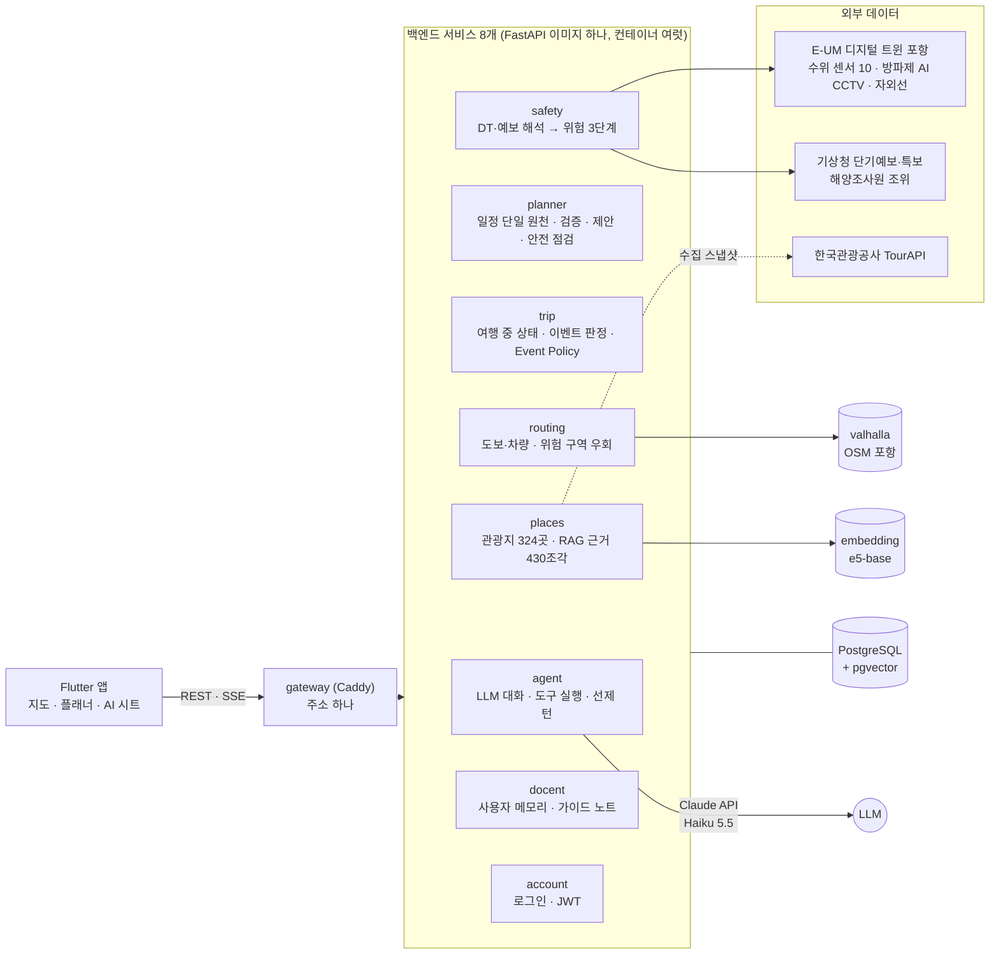
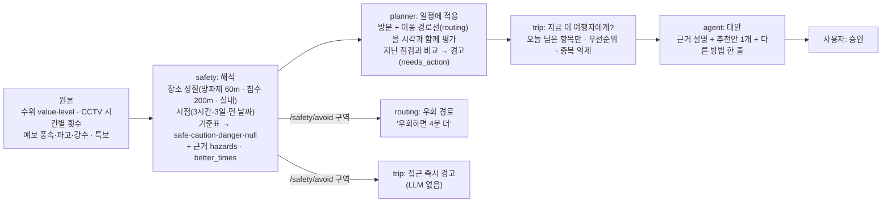
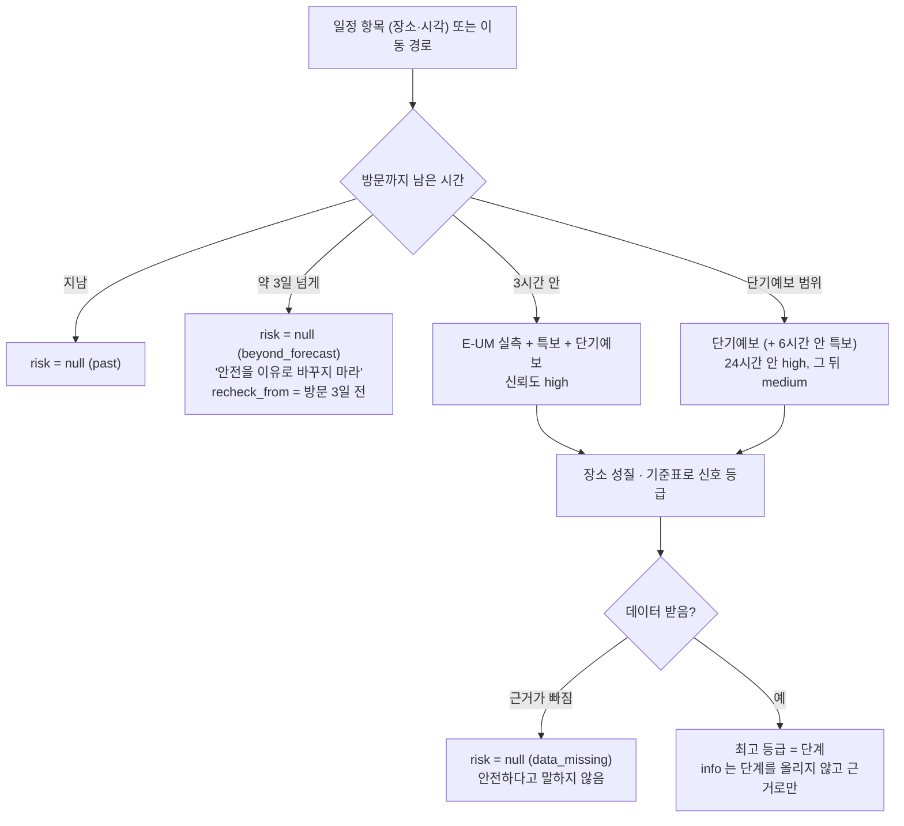
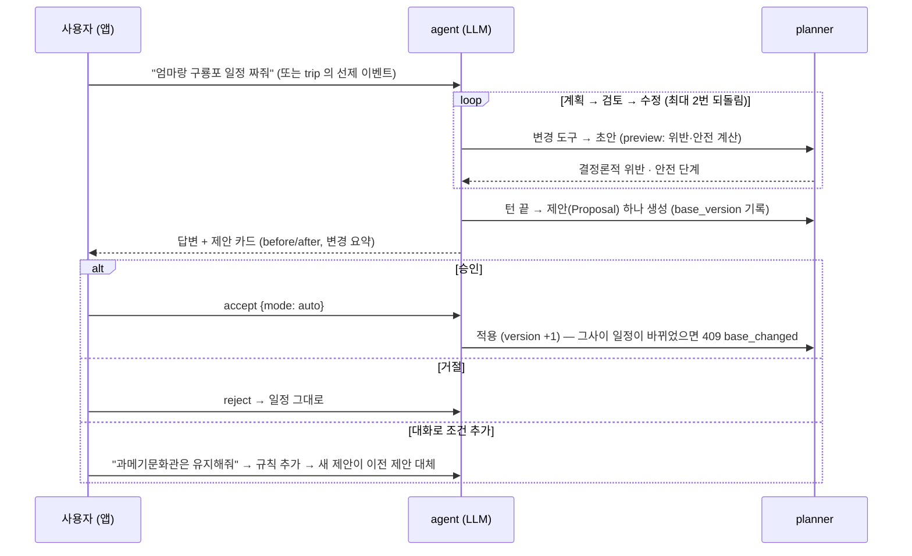

# architecture — 발표용 구조도 한 장

> 슬라이드 "기술 구조"에 쓰는 그림과 설명. 원본은 [README.md](../../README.md) "서비스 구성", [docs/COLLABORATION.md](../COLLABORATION.md) §1~§3,
> 각 서비스 README. 수치는 [facts.md](facts.md).

## 한 줄

**판단은 결정론적 서비스가, 말과 대안은 LLM 이, 결정은 사용자가.** 일정은 planner 하나에만 있고, LLM 은 제안(Proposal)만 만들며, 사용자가 승인해야 반영된다.

## 1. 서비스 구성

- 서비스끼리 코드를 import 하지 않고 **게이트웨이 경유 HTTP 로만** 부른다. 다른 서비스 테이블도 읽지 않는다 (접두사가 소유 경계) — COLLABORATION.md §2.
- 길찾기는 외부 지도 API 가 아니라 **직접 띄운 Valhalla** 다: 일정 한 번 바꿀 때 구간 수십 개를 계산하고, 위험 구역을 막은 경로를 요청마다 다시 계산해야 해서 — routing/README.md "왜 직접 띄우나".
- 키가 없어도 돈다: safety `mock`(가상 상황), 각본 LLM(`AGENT_PROVIDER=scripted`), routing 직선 근사, 장소 스냅샷 — README.md "키와 기능".

## 2. 데이터 흐름 — DT 데이터가 행동이 되기까지

- 원본 센서값을 그대로 화면이나 LLM 에 넘기지 않는다. safety 가 **"이 시각, 이 장소(또는 이 길)가 위험한가"** 로 바꾸고, 판단 근거와 한계(언제 정보인지, 얼마나 믿을지)를 함께 준다 — safety/README.md 첫 단락.
- 같은 날씨라도 장소마다 결론이 다르다: storm 에서 북방파제 `danger`, 근대문화역사관(실내) `safe + 참고` — safety/README.md §1.

## 3. 안전 판단 흐름 — 언제 판단하고 언제 판단하지 않는가

- `null` 은 단계가 아니라 **"모른다"** 다. 화면은 회색 "판단 불가", Agent 는 "안전하다"고 말하지도, 안전을 이유로 바꾸지도 않는다 — safety/README.md §2·§3, app/README.md §6.2.
- 데이터 장애를 '해제'로 오인하지 않는다: 판단하지 못한 항목은 지난 단계를 유지하고, 근거 일부가 빠진 결과로는 단계를 내리지 않는다 — planner/README.md §7.3.

## 4. 승인 흐름 — LLM 은 제안만 한다

- **검증은 LLM 이 아니라 알고리즘**: 운영시간·휴무·종료 시각·이동시간·긴 도보·사용자 규칙 — planner/README.md §2.4.
- **검토 관문**: LLM 이 답을 끝내려 하면 하네스가 같은 규칙으로 검토해 남은 문제(must·should)를 돌려보낸다. 되돌려진 답은 사용자에게 보내지 않는다 — agent/README.md §5.
- **충돌 보호**: 제안 이후 일정이 바뀌면 `base_changed`(확인창), 그사이 다녀온 곳을 바꾸는 제안은 `progress_changed`(다시 제안) — planner/README.md §5.4.
- **여행 중 금지**: 다녀온 항목 수정·지난 시각 고정 등은 하네스가 도구 단계에서 거부한다 — agent/README.md §11.3.

## 5. 여행 중 개입 — 필요한 순간에만

| 단계 | 언제 | 처리 | LLM |
|---|---|---|---|
| 0 | 진행 상태, 가벼운 지연 | 화면 상태만 | X |
| 1 | 출발, 위험 구역 접근, 안전 완화 | 고정 문구 · 긴급 패널 | X |
| 2 | 도착 | 해설 카드 (누르면 준비된 노트) | 누를 때만 |
| 3 | 새 위반이 생긴 지연, 남은 일정의 안전 상승 | **Agent 선제 턴** → 제안 카드 | O |

우선순위 안전 > 일정 영향 > 안내, 단계 3 은 한 번에 하나, 같은 원인은 다시 알리지 않음(거절 뒤에는 더 나빠질 때만), 쿨다운 10분(안전 제외) — trip/README.md §3·§4.
